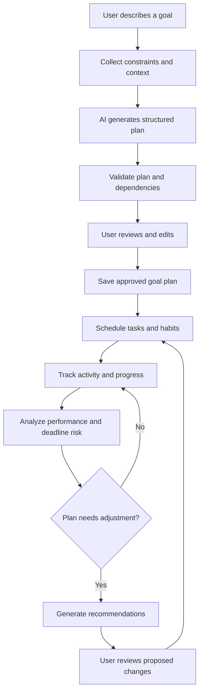

# Aspirra
### AI-Powered Adaptive Goal Planning Platform

> Turn ambitions into actionable plans — and adapt as life changes.

Aspirra is a proposed AI-powered web platform that helps people turn long-term goals into structured, realistic, and measurable plans. Users describe what they want to achieve in natural language, and Aspirra helps break that goal into milestones, tasks, habits, deadlines, and a schedule. As users work through the plan, the platform tracks progress, highlights risks, and recommends adjustments based on their activity.

> **Project status:** Initial concept / proposal  
> **Project type:** Academic team software project  
> **Working name:** Aspirra  
> **Note:** Features and technologies in this README are proposed and may change during requirements analysis and implementation.

---

## Table of Contents

- [1. Problem Statement](#1-problem-statement)
- [2. Vision](#2-vision)
- [3. Objectives](#3-objectives)
- [4. Proposed Solution](#4-proposed-solution)
- [5. Core Features](#5-core-features)
- [6. Example User Journey](#6-example-user-journey)
- [7. High-Level Workflow](#7-high-level-workflow)
- [8. Proposed System Modules](#8-proposed-system-modules)
- [9. AI and Intelligent Components](#9-ai-and-intelligent-components)
- [10. Proposed Architecture and Technology](#10-proposed-architecture-and-technology)
- [11. Initial Data Model](#11-initial-data-model)
- [12. Non-Functional Requirements](#12-non-functional-requirements)
- [13. MVP Scope](#13-mvp-scope)
- [14. Development Roadmap](#14-development-roadmap)
- [15. Success Metrics and Evaluation](#15-success-metrics-and-evaluation)
- [16. Risks and Considerations](#16-risks-and-considerations)
- [17. Open Questions](#17-open-questions)
- [18. Contributing](#18-contributing)

---

## 1. Problem Statement

People often set meaningful long-term goals but struggle to translate them into concrete actions. Goals can be too broad, plans may be unrealistic, and everyday responsibilities can make it difficult to maintain consistency. Traditional task and habit trackers help users record activities, but they may leave users to decide how to structure a goal, how to schedule its work, and how to recover when they fall behind.

Aspirra aims to bridge the gap between **deciding what to achieve** and **knowing what to do next**.

## 2. Vision

Build an intelligent planning platform that helps users turn ambitions into clear, actionable steps and continuously adjust those steps as their circumstances and progress change.

## 3. Objectives

- Convert natural-language goal descriptions into structured plans.
- Connect goals to milestones, tasks, and recurring habits.
- Help users create realistic schedules based on deadlines and availability.
- Track execution and provide clear progress analytics.
- Identify potential delays and estimate whether a goal is on track.
- Recommend practical plan adjustments when progress changes.
- Provide an AI coach grounded in the user's actual plan and activity.
- Offer a maintainable, secure, and extensible software platform.

## 4. Proposed Solution

Aspirra combines goal management, task and habit tracking, scheduling, analytics, and AI-assisted planning in one platform.

The main concept is a connected hierarchy:

```text
Goal
 ├── Milestone
 │    ├── Task
 │    ├── Task
 │    └── Habit
 ├── Milestone
 │    ├── Task
 │    └── Habit
 └── Progress and outcome metrics
```

A goal is not simply a title with a percentage. It has a desired outcome, a target date where applicable, measurable milestones, and the activities intended to move it forward. Completing tasks and recording habits contributes to progress, while the system keeps the relationships visible to the user.

AI-generated plans should be **editable proposals**, not unquestionable instructions. Users should be able to review, change, or reject suggested tasks and schedules before applying them.

## 5. Core Features

### 5.1 Goal Creation and Management
- Create goals with a description, target outcome, priority, and optional deadline.
- Categorize goals, set measurable success criteria, and track status.
- Edit, pause, archive, or complete goals.
- View goals in a dashboard and detailed goal workspace.

### 5.2 AI Goal Decomposition
- Accept a goal written in natural language.
- Ask follow-up questions when essential information is missing.
- Suggest milestones, tasks, habits, dependencies, estimates, and deadlines.
- Return structured data that can be validated before saving.
- Allow users to preview and edit the proposed plan.

### 5.3 Milestones and Tasks
- Organize work into milestones.
- Manage task descriptions, priorities, due dates, estimated duration, and status.
- Represent task dependencies where one task must precede another.
- Calculate milestone progress from its underlying work using documented rules.

### 5.4 Habit Tracking
- Create recurring habits linked to a goal or milestone.
- Record completions and review consistency over time.
- Support appropriate recurrence patterns and missed entries.
- Show how a habit is intended to support a goal.

### 5.5 Smart Scheduling
- Collect the user's available time and preferred working periods.
- Suggest a schedule based on task duration, priority, dependencies, and deadlines.
- Detect overloaded periods and scheduling conflicts.
- Let users approve or adjust the proposed schedule.

### 5.6 Adaptive Planning
- Detect when a plan is falling behind.
- Explain the factors contributing to delay, such as missed tasks or insufficient available time.
- Recommend rescheduling, reprioritization, or scope adjustments.
- Show proposed changes and request user approval before applying significant changes.

### 5.7 Progress Analytics and Predictions
- Show goal and milestone progress, task completion, and habit consistency.
- Compare planned activity with actual activity.
- Identify trends and possible deadline risks.
- Estimate likely completion dates or on-track status when enough reliable data exists.
- Explain estimates and uncertainty instead of presenting predictions as guarantees.

### 5.8 AI Goal Coach
- Answer questions about the user's current plans and progress.
- Summarize accomplishments and outstanding work.
- Explain why a goal may be behind schedule.
- Suggest practical next steps based on available user data.
- Respect permissions and only access data the user is authorized to view.

### 5.9 Notifications and Reminders
- Remind users about scheduled tasks and habits.
- Notify users about approaching deadlines and important plan changes.
- Support configurable notification preferences.
- Avoid excessive or repetitive notifications.

### 5.10 Optional Future Features
These features are not required for the initial MVP and should be considered only after the core experience works well:
- Shared goals and accountability partners.
- Collaborative or team goals with task assignment.
- Calendar integration.
- Weekly AI-generated progress reports.
- Additional integrations and export options.

## 6. Example User Journey

**Example goal:** “I want to become a .NET backend developer and be ready to apply for internships within eight months.”

1. **Describe:** The user enters the goal and their target timeframe.
2. **Clarify:** Aspirra asks about current experience, available study time, and other relevant constraints.
3. **Generate:** The AI proposes milestones such as C# fundamentals, Web API development, databases, security, projects, deployment, and interview preparation.
4. **Review:** The user edits and approves the proposed milestones, tasks, and habits.
5. **Schedule:** The system suggests a weekly plan based on the user's availability and task dependencies.
6. **Execute:** The user completes tasks and records recurring habits.
7. **Analyze:** Aspirra compares planned progress with actual progress and identifies possible delays.
8. **Adapt:** If the user falls behind, Aspirra proposes a revised schedule and explains the changes.
9. **Reflect:** The user reviews progress and adjusts the goal or plan when needed.

This is an illustrative example, not a claim that the platform can guarantee a career outcome.

## 7. High-Level Workflow



## 8. Proposed System Modules

The following is a starting point for dividing responsibilities and defining boundaries. The final module ownership should be agreed upon by the team.

| Module | Responsibility |
|---|---|
| Identity and User Profile | Authentication, profile, preferences, and availability |
| Goal Management | Goals, categories, target outcomes, and lifecycle |
| Planning and Tasks | Milestones, tasks, dependencies, and status |
| Habit Management | Recurrence rules, habit records, and consistency |
| AI Planning | Goal interpretation, plan generation, and structured output validation |
| Scheduling and Adaptation | Schedule proposals, conflict detection, and replanning |
| Analytics and Prediction | Progress calculations, trends, and deadline-risk estimates |
| AI Coach | Context-aware questions, summaries, and recommendations |
| Notifications | Reminders, preferences, and scheduled notifications |
| Administration | Operational overview, user support, and aggregate platform metrics |

For a manageable first release, several modules can be implemented together. A modular monolith is a reasonable starting architecture; separate microservices are not necessary unless a clear requirement emerges.

## 9. AI and Intelligent Components

AI should support the product's workflow rather than exist as a standalone chatbot.

### Goal decomposition
Use an LLM to interpret goal descriptions and propose structured milestones, tasks, habits, and estimates. Define a schema and validate generated output before it reaches the application.

### Scheduling and optimization
Use deterministic rules or an optimization algorithm for constraints such as task dependencies, available hours, due dates, and scheduling conflicts. The LLM may help interpret preferences, but should not be solely responsible for satisfying hard constraints.

### Progress analysis
Calculate progress from stored task and habit records using transparent rules. Use historical activity to identify trends and, if sufficient data is available, estimate deadline risk.

### Adaptive replanning
Combine actual progress, remaining work, deadlines, and user availability to produce a revised plan. Explain changes and let the user approve them.

### AI coach and grounding
Retrieve relevant information from the user's authorized goal and activity data before generating advice. Distinguish stored facts, calculated metrics, and AI-generated suggestions.

### Evaluation
AI output should be assessed for:
- Structural validity and completeness.
- Relevance to the stated goal.
- Actionability and appropriate granularity.
- Feasibility against user constraints.
- Consistency with task dependencies.
- User acceptance and amount of editing required.

The team should avoid claiming that AI-generated plans or completion predictions are accurate until they have been evaluated.

## 10. Proposed Architecture and Technology

These are **initial suggestions**, not finalized requirements.

| Layer | Candidate technology | Purpose |
|---|---|---|
| Frontend | Next.js / React with TypeScript | Responsive web application |
| Backend | ASP.NET Core Web API | Business logic and API |
| Database | PostgreSQL or SQL Server | Users, goals, tasks, habits, and activity |
| Data access | Entity Framework Core | Persistence and migrations |
| AI integration | An LLM API behind an application service | Goal decomposition and coaching |
| Background jobs | Hangfire or an equivalent scheduler | Reminders and scheduled processing |
| Authentication | ASP.NET Core Identity; token strategy to be decided | Identity and authorization |
| Deployment | Docker and Docker Compose | Reproducible environments and deployment |
| Testing | xUnit plus API/integration testing tools | Automated verification |
| CI | GitHub Actions | Build, test, and quality checks |

### Architectural principles
- Begin with a **modular monolith** and clear module boundaries.
- Keep AI-provider-specific code behind interfaces.
- Validate all input, including AI-generated structured output.
- Enforce authorization on the server for every user-owned resource.
- Keep API keys and secrets out of source control.
- Make progress calculations deterministic and testable.
- Add background processing only where asynchronous work is needed.
- Document architecture decisions as the design evolves.

## 11. Initial Data Model

A possible initial domain model:

- **User** — account and profile.
- **Goal** — owner, title, description, target outcome, deadline, priority, and status.
- **Milestone** — goal relationship, description, order, and completion criteria.
- **Task** — milestone or goal relationship, description, status, priority, estimate, due date, and dependencies.
- **Habit** — goal/milestone relationship, recurrence definition, and status.
- **HabitEntry** — dated record of a habit occurrence.
- **TaskActivity** — relevant task status changes and completion history.
- **Availability** — user-defined working periods and time constraints.
- **ScheduleItem** — proposed or approved placement of work in a time period.
- **PlanRevision** — plan version, reason for change, and approval state.
- **AIPlanGeneration** — generation metadata, validation result, and user edits, avoiding unnecessary sensitive prompt retention.
- **Notification** — recipient, type, scheduled time, and delivery status.

Relationships and fields should be refined through use cases, database design, and privacy requirements. Avoid storing duplicate progress values when they can be reliably derived; if snapshots are needed for history or performance, document how they are maintained.

## 12. Non-Functional Requirements

### Security and privacy
- Users can access only resources they own or are explicitly authorized to share.
- Store secrets in environment configuration or a secret manager.
- Protect authentication flows and validate inputs.
- Minimize personal data sent to external AI providers.
- Define retention and deletion rules for user data and AI-related records.

### Reliability
- Validate generated plans before saving them.
- Handle AI-provider failures, timeouts, rate limits, and malformed responses.
- Avoid duplicate notifications and repeated processing where possible.
- Provide understandable errors and preserve user edits.

### Usability and accessibility
- Make AI-generated plans easy to inspect and edit.
- Provide responsive layouts and clear empty, loading, and error states.
- Make progress metrics understandable and accessible.

### Maintainability and testability
- Separate business rules from controllers and external integrations.
- Use automated unit and integration tests.
- Document API contracts and significant architecture decisions.

### Performance
- Paginate larger collections and use database indexes where appropriate.
- Process slow AI calls and scheduled notifications asynchronously when necessary.
- Measure performance before adding infrastructure for scale.

## 13. MVP Scope

The first release should validate the core value before attempting every proposed feature.

### Must have
- User registration, authentication, and profile.
- Create and manage goals.
- AI-generated milestones and tasks from a goal description.
- Review and edit a generated plan before saving it.
- Link tasks and habits to goals/milestones.
- Record task and habit completion.
- Calculate and display goal progress.
- A basic schedule based on deadlines and user availability.
- Basic progress dashboard.
- Tests, documentation, and a deployable environment.

### Should have
- AI coach grounded in saved goal data.
- Missed-task detection and suggested replanning.
- Deadline-risk indicators with transparent rules.
- Notifications and reminders.

### Could have later
- Advanced optimization.
- Predictive models trained or calibrated on sufficient activity data.
- Shared goals and accountability partners.
- Calendar integrations and advanced administration analytics.

**Scope rule:** A reliable end-to-end workflow is more valuable than many incomplete features.

## 14. Development Roadmap

| Phase | Focus | Expected outcome |
|---|---|---|
| 1. Discovery | Problem validation, user personas, use cases, competitor review | Approved requirements and scope |
| 2. Design | User flows, wireframes, domain model, architecture decisions | Reviewed design and technical plan |
| 3. Foundation | Repository setup, CI, authentication, database, API conventions | Working application foundation |
| 4. Core Planning | Goals, milestones, tasks, habits, and progress rules | Usable non-AI planning workflow |
| 5. AI Planning | Structured goal decomposition, validation, editing flow | AI-generated plans users can review |
| 6. Scheduling | Availability, task constraints, schedule proposals | Initial smart scheduling |
| 7. Analytics and Adaptation | Progress dashboard, delay detection, replanning proposals | Evidence-based plan adjustment |
| 8. Quality and Release | Security review, usability testing, deployment, documentation | Evaluated project release |

The order and duration should be adjusted to the academic calendar, team capacity, and supervisor feedback.

## 15. Success Metrics and Evaluation

Define measurable acceptance criteria before implementation. Candidate metrics include:

- **Plan validity:** percentage of generated plans that pass schema and business-rule validation.
- **Plan usefulness:** user rating of relevance and actionability.
- **Editing effort:** amount of generated content users change before approval.
- **Scheduling feasibility:** percentage of proposed schedules that respect defined availability and dependency constraints.
- **Progress correctness:** tests confirming progress calculations for representative scenarios.
- **Prediction evaluation:** compare estimates with observed outcomes only when enough suitable data exists.
- **Reliability:** API error rate and handling of AI-provider failures.
- **Usability:** completion rate and feedback from representative test users.

For an academic evaluation, compare the AI-assisted workflow with a manual planning workflow using a small, clearly described user study. Report sample size, methodology, limitations, and results honestly.

## 16. Risks and Considerations

| Risk | Mitigation |
|---|---|
| Generated plans are vague or unrealistic | Use structured output, constraints, validation, and user review |
| AI output is inconsistent | Test representative cases and support retries or manual editing |
| Scope becomes too large | Prioritize the MVP and defer optional collaboration/integrations |
| Predictions lack enough data | Begin with transparent heuristic indicators; avoid unsupported accuracy claims |
| Scheduling ignores real constraints | Enforce hard constraints in deterministic scheduling logic |
| External AI costs or outages | Set usage limits, monitor costs, handle failures, and consider provider abstraction |
| Sensitive personal data exposure | Minimize collection, enforce authorization, and review provider data policies |
| Users lose trust after automatic changes | Show a diff and ask approval before significant replanning |

## 17. Open Questions

Resolve these as part of requirements analysis:

- Who is the initial target audience: students, professionals, or general users?
- Which goal categories will the MVP support?
- Which fields are required before AI plan generation?
- Which LLM provider or model will be used, and what is the budget?
- How will goal and milestone progress be calculated?
- Which scheduling constraints are hard requirements?
- Will the system support recurring tasks as well as habits?
- What data can the AI coach access, and how will it be retrieved?
- Will plan revisions always require user approval?
- What evaluation methodology is feasible within the project timeline?
- Which features are mandatory for supervisor acceptance?

## 18. Contributing

Aspirra is currently a project concept under development. Team members should:

1. Discuss and agree on requirements before implementing major features.
2. Create issues for work items and keep them small enough to review.
3. Use feature branches and pull requests.
4. Add tests for business rules and important bug fixes.
5. Update documentation when APIs, data models, or architecture decisions change.
6. Never commit credentials, API keys, or private user data.

### Suggested repository structure

```text
aspirra/
├── docs/
│   ├── requirements/
│   ├── architecture/
│   ├── diagrams/
│   └── decisions/
├── src/
│   ├── frontend/
│   └── backend/
├── tests/
├── .github/
│   └── workflows/
├── .env.example
├── .gitignore
└── README.md
```

Adjust this structure to match the team's final architecture.

---

## Project Summary

**Aspirra** aims to go beyond a conventional goal or habit tracker. Its central workflow is:

**Describe a goal → generate a structured plan → review and schedule it → track execution → analyze progress → adapt the plan.**

The project's main engineering challenge is to combine useful AI-generated plans with reliable task relationships, feasible scheduling, transparent progress calculations, and responsible adaptation based on real user activity.
