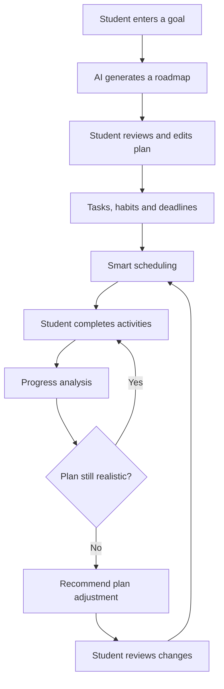
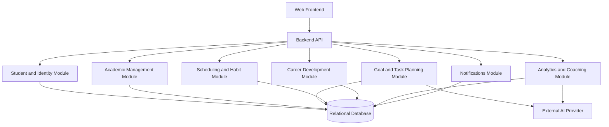

# Aspirra — Student Success & Career Planner

**AI-powered university student planning and development platform**

Every student has big goals, but turning them into daily action is the hard part. Aspirra is an AI-powered platform that makes it simple.

Share a goal like "reach a 3.5 GPA" or "land a software internship", and Aspirra builds your roadmap of milestones, tasks, habits, and deadlines. You stay in control by editing the plan, and Aspirra fits it around your real schedule.

Life gets busy and plans slip. When yours does, Aspirra warns you early and recommends a way back on track, and nothing changes until you approve it. Along the way it tracks your skills, projects, and portfolio, so every study session moves you closer to your career.

Study, habits, and career growth, all in one place.

> **Project:** CSE454 — Advanced Software Engineering  
> **Institution:** Alamein International University  
> **Status:** Academic project in planning and requirements analysis. Features and technologies below are proposed and may change as the team finalizes requirements.

## Contents

- [Problem Statement](#problem-statement)
- [Vision and Objectives](#vision-and-objectives)
- [Target Users](#target-users)
- [Core System Flow](#core-system-flow)
- [Proposed Features](#proposed-features)
- [Related Work](#related-work)
- [Suggested MVP](#suggested-mvp)
- [Proposed Architecture](#proposed-architecture)
- [Proposed Technology Stack](#proposed-technology-stack)
- [Team Ownership](#team-ownership)
- [Requirements and Traceability](#requirements-and-traceability)
- [Repository Structure](#repository-structure)
- [Development Workflow](#development-workflow)
- [Jira Project Management](#jira-project-management)
- [Quality Attributes](#quality-attributes)
- [Roadmap](#roadmap)
- [Getting Started](#getting-started)
- [Contributing](#contributing)
- [Team Members](#team-members)
- [License](#license)

## Problem Statement

Students don't fail from a lack of ability. They fail because nothing connects their goals to their daily actions.

Deadlines sit in a calendar, tasks in a notes app, grades on the university portal, and career plans only in the student's head. So goals stay too big to act on, schedules ignore real available time, and plans break when a single task is missed. Nobody warns the student early, and study stays disconnected from the skills and projects a career requires. The result is missed deadlines, lower grades, stress, and abandoned goals.

**What Aspirra solves:** Aspirra turns a goal into a realistic, editable plan, adapts it when the student falls behind, warns about risks early, and links daily study to career skills, all in one platform.

## Vision and Objectives

**Vision:** Help university students turn ambitions into realistic plans, understand their progress, and make steady progress toward academic success and career readiness.

**Objectives:**

- Centralize academic goals, courses, assignments, and exams.
- Turn natural-language goals into actionable milestones and tasks.
- Generate study plans that consider deadlines, availability, and progress.
- Support habit building and consistent progress tracking.
- Connect career goals with skills, projects, portfolios, and job preparation.
- Identify potential delays and suggest practical plan adjustments.

## Target Users

### Primary user: University student

University students are the people most affected, especially:

- **First-year students**, who are still learning to plan and are adjusting to the university workload.
- **Students with heavy workloads**, who juggle many courses, projects, and part-time work or activities.
- **Senior students**, who must balance coursework and graduation projects with portfolios and job applications.
- **Students who fall behind**, who have no easy way to recover once a plan breaks.

Students can organize academic work, set goals, receive AI-assisted plans, track habits and skills, monitor progress, and prepare for future careers.

### Potential secondary user: Platform administrator

An administrator may manage student accounts and review platform-level usage statistics. The final role permissions and scope must be defined during requirements analysis.

Instructors and academic advisors are affected indirectly, because they deal with late submissions and struggling students. They are not the main users of the system.

## Core System Flow

1. A student enters a goal in natural language.
2. AI proposes a roadmap containing milestones, tasks, habits, deadlines, and priorities.
3. The student reviews and edits the proposed plan.
4. The system schedules activities based on deadlines, priorities, workload, availability, and dependencies.
5. The student completes activities and records progress.
6. Aspirra analyzes progress and identifies missed tasks or possible risks.
7. Aspirra recommends adjustments, such as rescheduling or reprioritizing work, for the student to review.



AI-generated content is a suggestion, not guaranteed academic or career advice. Students should be able to review and edit plans before consequential schedule changes are applied.

## Proposed Features

The following list describes the intended product vision. The team will prioritize features against the agreed minimum viable product (MVP), course requirements, and available time.

|   # | Feature                        | Description                                                                                                      |
| --: | ------------------------------ | ---------------------------------------------------------------------------------------------------------------- |
|   1 | Student Profile                | Academic level, major, interests, skills, career interests, and availability.                                    |
|   2 | Academic Goal Management       | Semester goals, course goals, GPA targets, assignment goals, and exam goals.                                     |
|   3 | AI Goal Planner                | Convert a natural-language goal into milestones, tasks, habits, deadlines, and priorities.                       |
|   4 | AI Study Plan Generator        | Create personalized study plans and recommend adjustments based on progress and available time.                  |
|   5 | Course Management              | Manage courses, grades, assignments, projects, quizzes, exams, and course progress.                              |
|   6 | Assignment & Exam Planner      | Track deadlines, priorities, preparation schedules, and exam countdowns.                                         |
|   7 | Career Roadmap                 | Select a target career and track required skills, learning steps, and career progress.                           |
|   8 | Skill Tracking                 | Track technical and soft skills, skill levels, learning progress, and career skill requirements.                 |
|   9 | Project & Portfolio Management | Track projects, connect them to skills, and maintain a portfolio.                                                |
|  10 | Habit Management               | Track study, exercise, reading, coding, and other habits, including streaks and goal connections.                |
|  11 | Smart Scheduling               | Organize tasks using deadlines, priorities, workload, availability, and dependencies.                            |
|  12 | Adaptive Planning              | Detect when a student falls behind and recommend rescheduling or reprioritizing work.                            |
|  13 | AI Student Coach               | Provide personalized recommendations using the student's goals, tasks, habits, and progress.                     |
|  14 | Academic Performance Analytics | Show grade trends, course performance, study consistency, assignment completion, and GPA progress.               |
|  15 | Prediction & Early Warning     | Estimate goal completion and identify potential academic or deadline risks.                                      |
|  16 | Dashboard                      | Show today's tasks, upcoming deadlines, goal progress, habit streaks, academic performance, and career progress. |
|  17 | Notifications                  | Provide assignment, exam, study, missed-task, goal, and deadline reminders.                                      |
|  18 | Study Groups / Accountability  | Support shared goals, study groups, accountability partners, and shared progress.                                |
|  19 | Internship & Job Preparation   | Track applications, interview preparation, CV/portfolio progress, and required skills.                           |
|  20 | Admin Dashboard                | Support student management, system statistics, usage analytics, and activity monitoring.                         |

## Related Work

| System      | Description                                                                                                                                                      | Limitations                                                                                                                                                                                                                                 |
| ----------- | ---------------------------------------------------------------------------------------------------------------------------------------------------------------- | ------------------------------------------------------------------------------------------------------------------------------------------------------------------------------------------------------------------------------------------- |
| Shovel      | A student planner where AI turns natural language into tasks, imports timetables, syncs calendars, checks if the schedule is realistic, and tracks study streaks | Plans only short-term study tasks. No long-term goal roadmap, no career or skill tracking, no study groups, no early-warning prediction. Paid subscription                                                                                  |
| MyStudyLife | A free planner for classes, assignments, and exams, with deadline reminders and a Pomodoro timer.                                                                | Mostly manual entry. No AI planning, no goal breakdown, no adaptive rescheduling, no career or skill features.                                                                                                                              |
| StudntX     | An AI assistant that builds study plans around the student's schedule and tracks habits and streaks.                                                             | Focuses only on study plans and habits. No career roadmap, no skill or portfolio tracking, no analytics or early warning, no study groups.                                                                                                  |
| Reclaim.ai  | A web-based smart calendar that automatically blocks time for tasks and habits, and suggests a time-blocked day that the user approves or adjusts.               | Built as a general calendar, not for students. No course, grade, or exam tracking, no goal-to-plan breakdown, no career or skill features, no study groups. Its scheduling follows set rules rather than understanding the student's goals. |

### Comparison table

| Feature                                                  | Shovel | MyStudyLife | StudntX | Reclaim.ai | Aspirra |
| -------------------------------------------------------- | ------ | ----------- | ------- | ---------- | ------- |
| Natural-language input to tasks                          | Yes    | No          | Yes     | No         | Yes     |
| Full goal roadmap (milestones, tasks, habits, deadlines) | No     | No          | Partial | No         | Yes     |
| Course, assignment, and exam tracking                    | Yes    | Yes         | Yes     | No         | Yes     |
| AI study plan around availability                        | Yes    | No          | Yes     | Partial    | Yes     |
| Schedule feasibility check                               | Yes    | No          | No      | No         | Yes     |
| Adaptive replanning when behind (student approves)       | No     | No          | No      | Partial    | Yes     |
| Habit tracking with streaks                              | Yes    | No          | Yes     | Partial    | Yes     |
| Deadline reminders                                       | Yes    | Yes         | Yes     | Yes        | Yes     |
| Career roadmap and skill tracking                        | No     | No          | No      | No         | Yes     |
| Project and portfolio management                         | No     | No          | No      | No         | Yes     |
| Prediction and early warning                             | No     | No          | No      | No         | Yes     |
| Study groups and accountability                          | No     | No          | No      | No         | Yes     |
| Admin dashboard                                          | No     | No          | No      | No         | Yes     |

## Suggested MVP

The full vision is broad for a five-person academic team. A suggested initial MVP includes:

- Student profile and availability.
- Academic goals and milestones.
- Courses, assignments, and exam deadlines.
- AI-assisted goal decomposition into tasks and milestones.
- Basic study planning and task scheduling.
- Task completion and habit tracking.
- A dashboard showing upcoming tasks and goal progress.
- Basic progress analytics and reminders.

Advanced prediction, extensive AI coaching, study groups, and full career/job-preparation management can be prioritized for later phases if time is limited. The team should confirm the final MVP with the course requirements and teaching assistants.

## Proposed Architecture

A **modular monolith** is a practical starting point for a five-person team: modules have clear responsibilities and interfaces while sharing one deployable backend. The team can revisit the architecture after requirements and subsystem interfaces are finalized.



### Architecture principles

- Keep module responsibilities and dependencies explicit.
- Define interfaces for interactions between subsystems.
- Validate and authorize requests on the backend.
- Store structured student data in a relational database.
- Handle AI-provider errors, rate limits, and unavailable services.
- Validate AI output against an expected schema before saving it.
- Keep generated plans editable and require student review before consequential changes.
- Avoid unnecessary microservices and distributed-system complexity in the first version.

## Proposed Technology Stack

These are initial suggestions and must be agreed by the team before implementation.

| Layer | Proposed technology | Purpose |
|---|---|---|
| Frontend | React / Next.js with TypeScript | Responsive student web application |
| Backend | ASP.NET Core Web API with C# | API and application logic |
| Data access | Entity Framework Core | Data persistence and migrations |
| Database | PostgreSQL or SQL Server | Structured academic and planning data |
| AI integration | LLM API behind an application interface | Goal decomposition, study-plan suggestions, and coaching |
| Design | Figma | GUI screens and user flows |
| Project management | Jira Scrum | Backlog, epics, stories, sprints, estimates, and burndown |
| Source control | Git and GitHub | Monorepo, branches, pull requests, and reviews |
| Optional deployment | Docker Compose | Reproducible local environment |
| Optional CI | GitHub Actions | Automated build and test checks |

Do not commit API keys or other secrets. Use environment variables and keep local environment files untracked.

## Team Ownership

The assignment requires each of the five members to own four high-level functional requirements. The division below is final and matches the proposal, repository, and Jira labels.

| Member | Ownership area | Service/module labels |
|---|---|---|
| Ahmed Mohamed Ahmed / Team Leader | Academic management | `student-service`, `academic-service`, `course-service`, `assessment-service` |
| Yomna Mohamed Fekry | AI planning and scheduling | `goal-planner-service`, `study-planner-service`, `scheduling-service`, `adaptation-service` |
| Arwa Mohey Hamdy | Career and skill development | `career-service`, `skill-service`, `portfolio-service`, `job-preparation-service` |
| Mostafa Khamis Abozead | Habits, insights, and coaching | `habit-service`, `analytics-service`, `prediction-service`, `ai-coach-service` |
| Muhammed Hany Hamdy | Engagement and platform management | `dashboard-service`, `notification-service`, `study-group-service`, `administration-service` |

These names are logical ownership labels for planning and Jira; they do not require each module to be a separate deployable microservice. Final service names must match the team table, repository folders, and Jira story labels. Each high-level functional requirement should have one accountable owner and at least two low-level requirements.

## Requirements and Traceability

Use stable IDs throughout the proposal, diagrams, Jira, and implementation.

| Artifact | Suggested ID | Example |
|---|---|---|
| Business requirement | `BR-01` | Measurable business outcome |
| Customer requirement | `CR-01` | Student need or expectation |
| High-level functional requirement | `FR-01` | Manage Academic Goals |
| Low-level functional requirement | `FR-01.1` | One specific system behavior |
| Non-functional requirement | `NFR-01` | Measurable quality constraint |
| User story | `US-001` | User goal with acceptance criteria |
| Subsystem | `SUB-01` | Academic Management |
| Interface | `IAcademicService` | Subsystem contract |

Example traceability chain: `BR-01 → CR-01 → FR-01 → US-001 → Jira epic/story`.

User stories should follow:

> As a [user], I want [capability], so that [benefit].

Acceptance criteria should be testable and follow:

> Given [context], when [action], then [expected outcome].

## Repository Structure

Proposed monorepo layout; adjust it to match the final architecture and course requirements.

```text
aspirra/
├── .github/
│   ├── ISSUE_TEMPLATE/
│   └── pull_request_template.md
├── docs/
│   ├── requirements/
│   ├── architecture/
│   ├── diagrams/
│   ├── decisions/
│   └── proposal/
├── src/
│   ├── frontend/
│   └── backend/
│       └── Aspirra.Api/
├── tests/
├── .gitignore
└── README.md
```

For a modular monolith, backend modules can be folders or class libraries within one solution. Keep the structure consistent with the agreed subsystem design and service ownership.

## Development Workflow

### Branching strategy

The assignment requires:

- `main` — protected branch for reviewed, stable work.
- `develop` — shared integration branch.
- One feature branch per service, for example `feature/academic-service`.

### Pull request workflow

1. Confirm the related Jira task.
2. Create a feature branch from `develop`.
3. Make a focused change and add/update tests where appropriate.
4. Open a pull request into `develop` and link the Jira story.
5. Request review from another team member and address feedback.
6. Merge after the agreed checks pass; promote reviewed releases to `main` when appropriate.

Never commit secrets, generated build artifacts, or unrelated changes. Pull requests should describe the change and how it was tested; include screenshots for relevant UI changes.

## Jira Project Management

**Jira Scrum is required for this assignment; Trello is not accepted.** Recommended setup:

- One Jira Scrum project for Aspirra.
- One epic per high-level functional requirement.
- One story per user story, linked to its epic.
- Each story has its acceptance criteria, story points, assignee, and service-name label.
- A prioritized product backlog.
- Sprint 1 created and started from the backlog.
- Sprint 1 burndown chart available for submission.
- Both teaching assistants added to the Jira board.

Suggested workflow: `Backlog → Ready → In Progress → In Review → Done`.

Use the agreed working days per week, sprint length, and days-per-story-point assumption consistently. Before a sprint is completed, use planned sprint capacity as planned velocity; report actual velocity after completed sprints.

## Quality Attributes

The final proposal must contain three or four measurable non-functional requirements from different categories. The following are candidate examples to validate with the team and TA, not finalized commitments.

| Category | Candidate requirement |
|---|---|
| Performance | The API responds within 500 ms for 95% of ordinary non-AI requests under a defined test load. |
| Security | Protected student-data endpoints require authentication and enforce authorization, verified with an agreed set of access-control tests. |
| Reliability | Failed AI-provider requests are handled without losing previously saved student data in defined test scenarios. |
| Usability | A first-time test user can create a goal and review a generated plan within a specified time during a usability test. |

For each NFR, define the conditions and measurement method. Avoid vague terms such as “fast” or “secure” without measurable criteria.

## Roadmap

The course project is planned across 12 weeks. Sprint length and dates should be agreed by the team.

| Phase | Focus | Expected output |
|---|---|---|
| 1 | Project definition and requirements | Proposal, related work, requirements, traceability, initial use case diagram |
| 2 | Design and planning | Architecture, interfaces, data model, Figma screens, backlog and estimates |
| 3 | Foundation | Repository setup, frontend/backend foundation, database, initial integration |
| 4 | Core academic planning | Student profile, goals, courses, assessments, tasks, and deadlines |
| 5 | AI planning and scheduling | Goal decomposition, study-plan suggestions, scheduling |
| 6 | Progress and refinement | Habits, dashboard, basic analytics, testing, improvements |
| 7 | Final validation | Integration, documentation, demonstration, and submission preparation |

This roadmap is indicative. The detailed sprint plan must use story estimates, team capacity, dependencies, and the course deadline.

## Getting Started

Development commands will be added after the team finalizes the technology stack and repository structure.

Expected tools, depending on the final stack:

- Git
- .NET SDK compatible with the chosen ASP.NET Core version
- Node.js and the chosen package manager
- Database server or Docker environment, if selected
- An AI-provider API key for AI features, if required

Initial setup:

1. Clone the repository.
2. Review the requirements and architecture documents in `docs/`.
3. Configure local environment variables according to the team's setup instructions.
4. Start the required development services.
5. Run the frontend, backend, and tests using instructions to be added when the stack is confirmed.

Never commit real credentials. Add local environment files to `.gitignore` and use an example environment file with placeholder values when needed.

## Team Members

| University ID | Name | University email | GitHub username | Owned services |
|---|---|---|---|---|
| 23101359 | Ahmed Mohamed Ahmed | ahmed.abdo.2024@aiu.edu.eg | AbooSalh | `student-service`, `academic-service`, `course-service`, `assessment-service` |
| 23101506 | Yomna Mohamed Fekry | yomna.hosney.2024@aiu.edu.eg | YomnaElmenawy | `goal-planner-service`, `study-planner-service`, `scheduling-service`, `adaptation-service` |
| 23101371 | Arwa Mohey Hamdy | arwa.hamdy.2024@aiu.edu.eg | ArwaMohey | `career-service`, `skill-service`, `portfolio-service`, `job-preparation-service` |
| 23101484 | Mostafa Khamis Abozead | mostafa.abozead.2024@aiu.edu.eg | Mostafa-abozead | `habit-service`, `analytics-service`, `prediction-service`, `ai-coach-service` |
| 23102359 | Muhammed Hany Hamdy | mohamed.abuaaliyah.2024@aiu.edu.eg | muhammedhanii | `dashboard-service`, `notification-service`, `study-group-service`, `administration-service` |

Each member owns four services. The service names match the repository and Jira labels. Add all team members and the teaching assistants to the GitHub repository and Jira project as required.

**Jira board:** [Aspirra Project — SCRUM board](https://aspirra.atlassian.net/jira/software/projects/SCRUM/boards/1)

## License

No license has been selected yet. Add a license after the team agrees on reuse and distribution terms.
