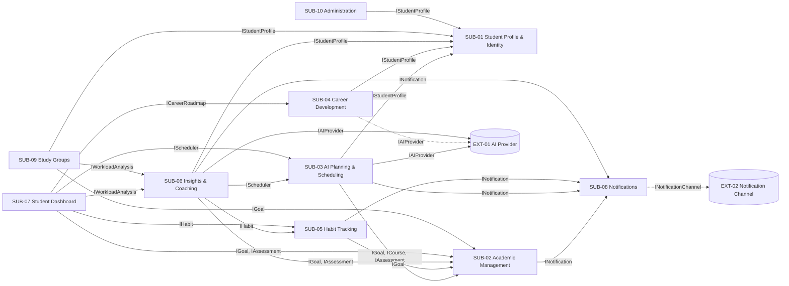

# B6 — Subsystems, interfaces & traceability

> Issue: #6 · Part: B · Owner: TBD · Reviewer: TBD · Status: Draft

## Content

Aspirra is a modular monolith (README § Proposed Architecture). Each subsystem below is a backend module with its own data, and it offers one provided interface for each high-level FR it implements. A subsystem may use another subsystem only through that subsystem's provided interface and never reads another subsystem's tables directly (README § Architecture principles). Subsystem IDs follow the README convention `SUB-NN`, and interface names follow `I<Name>`.

### Conventions

- **Provided interface**: the contract a subsystem offers to the frontend and to other subsystems.
- **Required interface**: an interface of another subsystem or an external system that this subsystem calls.
- **(internal)**: the required interface belongs to the same subsystem. It is shown so the full chain for each FR is visible.
- **[Proposed — requires team approval]**: a design choice that the README and B4 do not document.

### 1. Subsystems and their FRs

| ID | Subsystem | High-level FRs (B4) | Owner | Service labels (README § Team Ownership) |
|---|---|---|---|---|
| SUB-01 | Student Profile & Identity | FR-01 Manage Student Profile | Ahmed Mohamed Ahmed | `student-service` |
| SUB-02 | Academic Management | FR-02 Manage Academic Goals FR-03 Manage Courses FR-04 Manage Assignments and Exams | Ahmed Mohamed Ahmed | `academic-service`, `course-service`, `assessment-service` |
| SUB-03 | AI Planning & Scheduling | FR-05 Plan Goals with AI FR-06 Generate Study Plans FR-07 Enable Smart Scheduling FR-08 Enable Adaptive Planning | Yomna Mohamed Fekry | `goal-planner-service`, `study-planner-service`, `scheduling-service`, `adaptation-service` |
| SUB-04 | Career Development | FR-09 Manage Career Roadmaps FR-10 Track Skills FR-11 Manage Projects and Portfolios FR-12 Manage Internship and Job Preparation | Arwa Mohey Hamdy | `career-service`, `skill-service`, `portfolio-service`, `job-preparation-service` |
| SUB-05 | Habit Tracking | FR-13 Manage Habits | Mostafa Khamis Abozead | `habit-service` |
| SUB-06 | Insights & Coaching | FR-14 Analyze Study Workload FR-15 Predict and Warn Early FR-16 Coach Students with AI | Mostafa Khamis Abozead | `analytics-service`, `prediction-service`, `ai-coach-service` |
| SUB-07 | Student Dashboard | FR-17 Display Student Dashboard | Muhammed Hany Hamdy | `dashboard-service` |
| SUB-08 | Notifications | FR-18 Send Notifications | Muhammed Hany Hamdy | `notification-service` |
| SUB-09 | Study Groups & Accountability | FR-19 Manage Study Groups and Accountability | Muhammed Hany Hamdy | `study-group-service` |
| SUB-10 | Administration | FR-20 Manage Administration | Muhammed Hany Hamdy | `administration-service` |

Each of the 20 high-level FRs belongs to exactly one subsystem, and each of the 20 README service labels maps to exactly one subsystem. The README diagram shows seven modules. B4 adds dashboard, study-group, and administration FRs that do not fit any of those modules, so they are separate subsystems here. Habits are also separated from scheduling because FR-13 and FR-07 have different owners.

#### External systems

| ID | External system | Interface | Used by |
|---|---|---|---|
| EXT-01 | AI provider (LLM API, README § Proposed Technology Stack) | `IAIProvider` | SUB-03, SUB-06, and SUB-04 [Proposed — requires team approval] |
| EXT-02 | Notification delivery service (email or web push) [Proposed — requires team approval] | `INotificationChannel` | SUB-08 |
| — | Relational database (PostgreSQL or SQL Server) | Each subsystem accesses only its own tables through Entity Framework Core. The database is therefore not listed as a required interface in the tables below. | All |

### 2. Provided interface per subsystem

Each operation is followed by the low-level FRs it realizes.

| Subsystem | Provided interface | Realizes | Main operations (→ low-level FRs) |
|---|---|---|---|
| SUB-01 | `IStudentProfile` | FR-01 | `CreateProfile` (FR-01.1, FR-01.4) `UpdateProfile` (FR-01.2, FR-01.4) `GetProfile` (FR-01.3) `GetAvailability` (read by SUB-03, SUB-06) |
| SUB-01 | `IIdentity` | NFR-02; supports FR-20 | `Authenticate`, `AuthorizeOwner`, `RequireRole` (NFR-02) `GetAccount` (FR-20.1, FR-20.8) `CreateAccount`, `UpdateAccount`, `SuspendAccount` (FR-20.2–FR-20.4, FR-20.9) `GetActivityStats` (FR-20.5–FR-20.7, FR-20.10) [Proposed — requires team approval] |
| SUB-02 | `IGoal` | FR-02 | `CreateGoal` (FR-02.1) `UpdateGoal` (FR-02.2) `ChangeTargetDate` (FR-02.3) `CompleteGoal` (FR-02.4) `ArchiveGoal` (FR-02.5) `DeleteGoal` (FR-02.6) `GetActiveGoals` (read by SUB-03, SUB-05, SUB-06, SUB-07, SUB-09) |
| SUB-02 | `ICourse` | FR-03 | `AddCourse` (FR-03.1) `SetCreditsAndWorkload` (FR-03.2) `GetCourseProgress` (FR-03.3) `UpdateCourse` (FR-03.4) `RemoveCourse` (FR-03.5) `GetCourses` (read by SUB-03) |
| SUB-02 | `IAssessment` | FR-04 | `AddAssignment` (FR-04.1) `AddExam` (FR-04.2) `SetAssignmentStatus` (FR-04.3) `SetExamReminder` (FR-04.4) `GetUpcomingDeadlines` (read by SUB-03, SUB-06, SUB-07) |
| SUB-03 | `IGoalPlanner` | FR-05 | `SubmitGoalText` (FR-05.1) `GenerateRoadmapDraft` (FR-05.2) `GetDraft` (FR-05.3) `EditDraftMilestone` (FR-05.4) `EditDraftTask` (FR-05.5) `ApproveDraft` (FR-05.6) |
| SUB-03 | `IStudyPlanner` | FR-06 | `GenerateStudyPlan` (FR-06.1, FR-06.2) `RegenerateStudyPlan` (FR-06.3) `ValidatePlan` (FR-06.4) `GetCurrentStudyPlan` (FR-06.5) |
| SUB-03 | `IScheduler` | FR-07 | `ScheduleTasks` (FR-07.1) `DetectConflicts` (FR-07.2) `SuggestAlternativeSlots` (FR-07.3) `AdjustScheduledTask` (FR-07.4) `GetScheduledTasks` (read by SUB-06, SUB-07) `SetTaskStatus` (see open point 1) |
| SUB-03 | `IAdaptivePlanner` | FR-08 | `DetectFallingBehind` (FR-08.1) `GetRescheduleRecommendations` (FR-08.2) `GetReprioritizeRecommendations` (FR-08.3) `AcceptRecommendation` (FR-08.4, FR-08.5) `RejectRecommendation` (FR-08.6) `ModifyRecommendation` (FR-08.7) |
| SUB-04 | `ICareerRoadmap` | FR-09 | `ListCareers`, `SelectCareer` (FR-09.1) `SetCustomCareer` (FR-09.2) `GenerateRoadmap` (FR-09.3) `UpdateMilestoneProgress` (FR-09.4) `ChangeTargetCareer` (FR-09.5, FR-09.6) `GetCareerProgress` (read by SUB-07) |
| SUB-04 | `ISkill` | FR-10 | `AddSkill` (FR-10.1) `CompareWithCareer` (FR-10.2) `GetSkillGaps` (FR-10.3) `UpdateSkillLevel` (FR-10.4) |
| SUB-04 | `IPortfolio` | FR-11 | `AddProject` (FR-11.1) `LinkProjectToSkill` (FR-11.2) `GetPortfolio` (FR-11.3) `AddProjectLink` (FR-11.4) |
| SUB-04 | `IJobPreparation` | FR-12 | `AddApplication` (FR-12.1) `AddInterviewPrepTask` (FR-12.2) `RecordCvUpdate` (FR-12.3) `RecordPortfolioUpdate` (FR-12.4) `RecordOutcome` (FR-12.5) `RecordFeedback` (FR-12.6) |
| SUB-05 | `IHabit` | FR-13 | `CreateHabit` (FR-13.1) `MarkHabitDone` (FR-13.2) `GetStreaks` (FR-13.3; read by SUB-06, SUB-07) `LinkHabitToGoal` (FR-13.4) |
| SUB-06 | `IWorkloadAnalysis` | FR-14 | `GetRemainingWorkload` (FR-14.1) `GetRemainingStudyTime` (FR-14.2) `GetCompletionPercentage` (FR-14.3) `GetWorkloadSummary` (FR-14.4; read by SUB-07, SUB-09) `IsOverloaded` (FR-14.5) |
| SUB-06 | `IEarlyWarning` | FR-15 | `EstimateCompletionLikelihood` (FR-15.1) `GetActiveWarnings` (FR-15.2) `GetOverloadingTasks` (FR-15.3) `GetRecoveryActions` (FR-15.4) |
| SUB-06 | `IAICoach` | FR-16 | `GetRecommendations` (FR-16.1) `GetStudyAdvice` (FR-16.2) `GetRecoveryStrategies` (FR-16.3) `GetMotivationalGuidance` (FR-16.4) |
| SUB-07 | `IDashboard` | FR-17 | `GetTodayAndDeadlines` (FR-17.1) `GetGoalStatus` (FR-17.2) `GetGoalCompletion` (FR-17.3) `GetHabitSummary` (FR-17.4) `GetWorkloadSummary` (FR-17.5) `GetCareerProgress` (FR-17.6) |
| SUB-08 | `INotification` | FR-18 | `ScheduleReminder` (FR-18.1, FR-18.2, FR-18.3, FR-18.5) `SendNotification` (FR-18.4, FR-18.6) `CancelReminder` `GetNotifications`, `MarkAsRead` |
| SUB-09 | `IStudyGroup` | FR-19 | `CreateGroup` (FR-19.1) `JoinGroup` (FR-19.2) `ShareGoal` (FR-19.3) `GetGroupProgress` (FR-19.4) `FindPartner` (FR-19.5) `ConnectPartner` (FR-19.6) `PostProgressUpdate` (FR-19.7) `PostSupportMessage` (FR-19.8) |
| SUB-10 | `IAdministration` | FR-20 | `GetStudentAccount` (FR-20.1) `CreateStudentAccount` (FR-20.2) `UpdateStudentAccount` (FR-20.3) `SuspendStudentAccount` (FR-20.4) `GetUsageStatistics` (FR-20.5, FR-20.6, FR-20.7) `InvestigateAccountIssue` (FR-20.8) `ResolveAccountIssue` (FR-20.9) `GetRetentionMetrics` (FR-20.10) |

#### External interfaces

| Interface | External system | Main operations |
|---|---|---|
| `IAIProvider` | EXT-01 | `GenerateStructured(prompt, schema)` returns output that has been validated against the expected schema, or a defined error: provider error, rate limited, unavailable, or invalid output. This supports FR-06.4, FR-06.5, and NFR-03. |
| `INotificationChannel` | EXT-02 | `Deliver(recipient, message)` [Proposed — requires team approval] |

### 3. Required interfaces per subsystem

Every subsystem except SUB-01 requires `IIdentity` (SUB-01) to authenticate the caller and check record ownership on each request (NFR-02).

| Subsystem | Required interface | Provided by | Used for (low-level FRs) |
|---|---|---|---|
| SUB-01 | — | — | Uses only its own tables. |
| SUB-02 | `IIdentity` | SUB-01 | Authentication and ownership checks (NFR-02) |
| SUB-02 | `INotification` | SUB-08 | Exam preparation reminders (FR-04.4 → FR-18.1); assignment and exam deadline reminders (FR-18.1) |
| SUB-03 | `IIdentity` | SUB-01 | Authentication and ownership checks (NFR-02) |
| SUB-03 | `IStudentProfile` | SUB-01 | Student availability for planning and scheduling (FR-06.1, FR-06.3, FR-07.1) |
| SUB-03 | `IGoal` | SUB-02 | Attach approved milestones and tasks to the goal (FR-05.6); goal target dates (FR-06.1) |
| SUB-03 | `ICourse` | SUB-02 | Courses and weekly workload (FR-06.1, FR-07.1) |
| SUB-03 | `IAssessment` | SUB-02 | Assignment and exam deadlines (FR-06.1, FR-07.1, FR-08.1) |
| SUB-03 | `INotification` | SUB-08 | Study-task reminders (FR-18.2) and goal milestone reminders (FR-18.5) |
| SUB-03 | `IAIProvider` | EXT-01 | Roadmap generation (FR-05.2); study-plan generation and regeneration (FR-06.1, FR-06.3) with schema validation (FR-06.4, NFR-03) |
| SUB-04 | `IIdentity` | SUB-01 | Authentication and ownership checks (NFR-02) |
| SUB-04 | `IStudentProfile` | SUB-01 | Career interests for career selection (FR-09.1); reuse of the skills recorded in the profile (FR-01.1 → FR-10.1) |
| SUB-04 | `IAIProvider` | EXT-01 | Career roadmap generation, including custom careers (FR-09.2, FR-09.3, FR-09.6) [Proposed — requires team approval] |
| SUB-05 | `IIdentity` | SUB-01 | Authentication and ownership checks (NFR-02) |
| SUB-05 | `IGoal` | SUB-02 | Link habits to academic goals (FR-13.4) |
| SUB-05 | `INotification` | SUB-08 | Habit reminders from the habit's reminder settings (FR-13.1 → FR-18.3); streak milestones (FR-13.3 → FR-18.6) |
| SUB-06 | `IIdentity` | SUB-01 | Authentication and ownership checks (NFR-02) |
| SUB-06 | `IStudentProfile` | SUB-01 | Availability for the remaining study time (FR-14.2) |
| SUB-06 | `IGoal` | SUB-02 | Active goals and target dates (FR-14.1, FR-14.2, FR-16.1) |
| SUB-06 | `IAssessment` | SUB-02 | Upcoming deadlines for study advice (FR-16.2) |
| SUB-06 | `IScheduler` | SUB-03 | Unfinished scheduled tasks and their durations (FR-14.1, FR-14.3, FR-15.3, FR-16.1) |
| SUB-06 | `IHabit` | SUB-05 | Habits for personalized recommendations (FR-16.1) |
| SUB-06 | `INotification` | SUB-08 | Early warning notifications (FR-15.2 → FR-18.4) |
| SUB-06 | `IAIProvider` | EXT-01 | Coaching recommendations, advice, recovery strategies, and motivational guidance (FR-16.1–FR-16.4) |
| SUB-07 | `IIdentity` | SUB-01 | Authentication and ownership checks (NFR-02) |
| SUB-07 | `IScheduler` | SUB-03 | Today's tasks (FR-17.1) |
| SUB-07 | `IAssessment` | SUB-02 | Upcoming deadlines (FR-17.1) |
| SUB-07 | `IGoal` | SUB-02 | Goal status (FR-17.2) |
| SUB-07 | `IWorkloadAnalysis` | SUB-06 | Goal completion percentage (FR-17.3 = FR-14.3); workload summary (FR-17.5) |
| SUB-07 | `IHabit` | SUB-05 | Habit streaks and completion status (FR-17.4) |
| SUB-07 | `ICareerRoadmap` | SUB-04 | Career progress (FR-17.6) |
| SUB-08 | `IIdentity` | SUB-01 | Recipient account and contact address (FR-18.1–FR-18.6) |
| SUB-08 | `INotificationChannel` | EXT-02 | Delivery of reminders and notifications (FR-18.1–FR-18.6) [Proposed — requires team approval] |
| SUB-09 | `IIdentity` | SUB-01 | Authentication and ownership checks (NFR-02) |
| SUB-09 | `IStudentProfile` | SUB-01 | Major, interests, and availability for partner matching (FR-19.5) |
| SUB-09 | `IGoal` | SUB-02 | Goals that members share (FR-19.3) |
| SUB-09 | `IWorkloadAnalysis` | SUB-06 | Group progress and progress updates (FR-19.4, FR-19.7) |
| SUB-10 | `IIdentity` | SUB-01 | Administrator role check (NFR-02); account operations (FR-20.1–FR-20.4, FR-20.9); registered, active, feature-usage, and retention figures (FR-20.5–FR-20.7, FR-20.10) |
| SUB-10 | `IStudentProfile` | SUB-01 | Student profile details for viewing and investigation (FR-20.1, FR-20.8) |

#### Dependency diagram

The edges from every subsystem to `IIdentity` (SUB-01) are left out for readability. Dashed edges are [Proposed — requires team approval].

The dependency graph has no cycles. SUB-01 depends on nothing, and SUB-08 depends only on SUB-01 and EXT-02. Any subsystem can therefore push reminders to `INotification` without creating a cycle. Source subsystems push reminders and alerts to SUB-08, and SUB-08 never reads from them.

### 4. Traceability matrix

There is one row per subsystem. The subsystem's high-level FRs are listed in the order of its provided and required interfaces, so the n-th FR is realized by the n-th provided interface. A required interface is listed once even when several of the subsystem's FRs use it. Section 3 shows which low-level FRs use each required interface.

| Subsystem | High-level FRs | Provided interfaces | Required interfaces — other subsystems | Required interfaces — external |
|---|---|---|---|---|
| SUB-01 Student Profile & Identity | FR-01 Manage Student Profile (NFR-02, supports FR-20) | `IStudentProfile` `IIdentity` | — | — |
| SUB-02 Academic Management | FR-02 Manage Academic Goals FR-03 Manage Courses FR-04 Manage Assignments and Exams | `IGoal` `ICourse` `IAssessment` | `IIdentity` (SUB-01) `INotification` (SUB-08) | — |
| SUB-03 AI Planning & Scheduling | FR-05 Plan Goals with AI FR-06 Generate Study Plans FR-07 Enable Smart Scheduling FR-08 Enable Adaptive Planning | `IGoalPlanner` `IStudyPlanner` `IScheduler` `IAdaptivePlanner` | `IIdentity`, `IStudentProfile` (SUB-01) `IGoal`, `ICourse`, `IAssessment` (SUB-02) `INotification` (SUB-08) | `IAIProvider` (EXT-01) |
| SUB-04 Career Development | FR-09 Manage Career Roadmaps FR-10 Track Skills FR-11 Manage Projects and Portfolios FR-12 Manage Internship and Job Preparation | `ICareerRoadmap` `ISkill` `IPortfolio` `IJobPreparation` | `IIdentity`, `IStudentProfile` (SUB-01) | `IAIProvider` (EXT-01) [Proposed — requires team approval] |
| SUB-05 Habit Tracking | FR-13 Manage Habits | `IHabit` | `IIdentity` (SUB-01) `IGoal` (SUB-02) `INotification` (SUB-08) | — |
| SUB-06 Insights & Coaching | FR-14 Analyze Study Workload FR-15 Predict and Warn Early FR-16 Coach Students with AI | `IWorkloadAnalysis` `IEarlyWarning` `IAICoach` | `IIdentity`, `IStudentProfile` (SUB-01) `IGoal`, `IAssessment` (SUB-02) `IScheduler` (SUB-03) `IHabit` (SUB-05) `INotification` (SUB-08) | `IAIProvider` (EXT-01) |
| SUB-07 Student Dashboard | FR-17 Display Student Dashboard | `IDashboard` | `IIdentity` (SUB-01) `IGoal`, `IAssessment` (SUB-02) `IScheduler` (SUB-03) `ICareerRoadmap` (SUB-04) `IHabit` (SUB-05) `IWorkloadAnalysis` (SUB-06) | — |
| SUB-08 Notifications | FR-18 Send Notifications | `INotification` | `IIdentity` (SUB-01) | `INotificationChannel` (EXT-02) [Proposed — requires team approval] |
| SUB-09 Study Groups & Accountability | FR-19 Manage Study Groups and Accountability | `IStudyGroup` | `IIdentity`, `IStudentProfile` (SUB-01) `IGoal` (SUB-02) `IWorkloadAnalysis` (SUB-06) | — |
| SUB-10 Administration | FR-20 Manage Administration | `IAdministration` | `IIdentity`, `IStudentProfile` (SUB-01) | — |

#### FR × subsystem view

The same traceability with one row per high-level FR. **P** means the subsystem provides the FR's interface. **R** means the FR requires an interface from that subsystem or external system. **R\*** marks a [Proposed — requires team approval] dependency. Interfaces that a subsystem requires from itself are not marked as R here.

| FR | SUB-01 | SUB-02 | SUB-03 | SUB-04 | SUB-05 | SUB-06 | SUB-07 | SUB-08 | SUB-09 | SUB-10 | EXT-01 | EXT-02 |
|---|---|---|---|---|---|---|---|---|---|---|---|---|
| FR-01 | P |  |  |  |  |  |  |  |  |  |  |  |
| FR-02 | R | P |  |  |  |  |  |  |  |  |  |  |
| FR-03 | R | P |  |  |  |  |  |  |  |  |  |  |
| FR-04 | R | P |  |  |  |  |  | R |  |  |  |  |
| FR-05 | R | R | P |  |  |  |  |  |  |  | R |  |
| FR-06 | R | R | P |  |  |  |  |  |  |  | R |  |
| FR-07 | R | R | P |  |  |  |  | R |  |  |  |  |
| FR-08 | R | R | P |  |  |  |  |  |  |  |  |  |
| FR-09 | R |  |  | P |  |  |  |  |  |  | R\* |  |
| FR-10 | R |  |  | P |  |  |  |  |  |  |  |  |
| FR-11 | R |  |  | P |  |  |  |  |  |  |  |  |
| FR-12 | R |  |  | P |  |  |  |  |  |  |  |  |
| FR-13 | R | R |  |  | P |  |  | R |  |  |  |  |
| FR-14 | R | R | R |  |  | P |  |  |  |  |  |  |
| FR-15 | R |  | R |  |  | P |  | R |  |  |  |  |
| FR-16 | R | R | R |  | R | P |  |  |  |  | R |  |
| FR-17 | R | R | R | R | R | R | P |  |  |  |  |  |
| FR-18 | R |  |  |  |  |  |  | P |  |  |  | R\* |
| FR-19 | R | R |  |  |  | R |  |  | P |  |  |  |
| FR-20 | R |  |  |  |  |  |  |  |  | P |  |  |

### 5. Open points for the team

1. **Task completion has no FR.** FR-08.1, FR-14.1, and FR-14.3 depend on knowing which scheduled tasks are finished, but B4 has no low-level FR that lets the student mark a scheduled task as done. `IScheduler.SetTaskStatus` is included to cover this. We propose adding FR-07.5 to B4: "The system shall allow a student to mark a scheduled task as completed."
2. **Authentication is not a high-level FR.** `IIdentity` exists to satisfy NFR-02 and to serve the account operations in FR-20. B4 has no FR for student self-registration or sign-in. If the team wants students to create their own accounts, an FR must be added. Recording sign-in and feature-usage activity in `IIdentity` for FR-20.5–FR-20.7 and FR-20.10 is [Proposed — requires team approval].
3. **Skills are recorded in two places.** FR-01.1 records skills in the profile and FR-10.1 records skills with levels. In this design SUB-04 owns skill data and imports the skills already entered in the profile through `IStudentProfile`. The team should confirm that the profile does not keep its own separate copy of the skills.
4. **Recovery advice appears in three FRs.** FR-08.2/FR-08.3 (SUB-03), FR-15.4, and FR-16.3 (both SUB-06) all suggest ways to recover. Proposed rule [Proposed — requires team approval]: only `IAdaptivePlanner` changes the plan, and only after student approval (FR-08.4). The suggestions from SUB-06 are advisory and do not change the plan.

## Checklist

- [x] Define subsystems and map FRs to them
- [x] Specify provided interface per subsystem
- [x] Specify required interfaces per subsystem
- [x] Build the traceability matrix
- [ ] Teammate review of this deliverable — not yet performed, so Reviewer stays TBD and Status stays Draft
