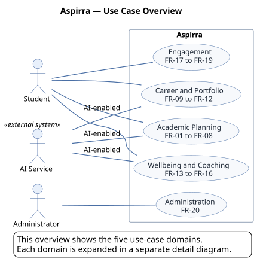
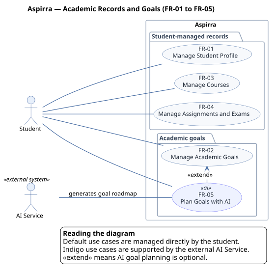
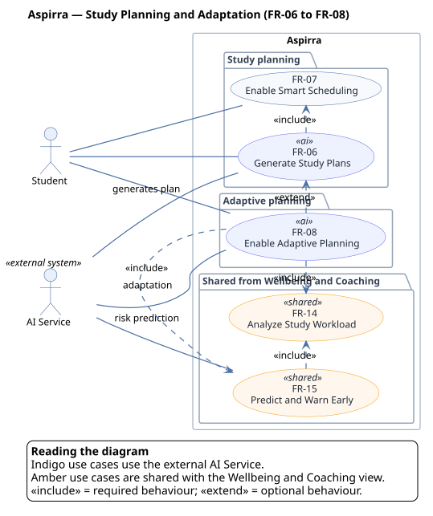
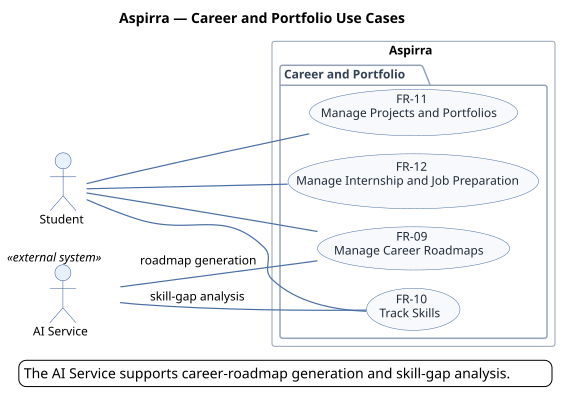
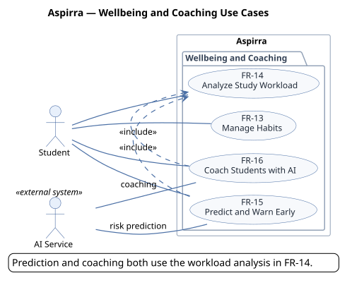
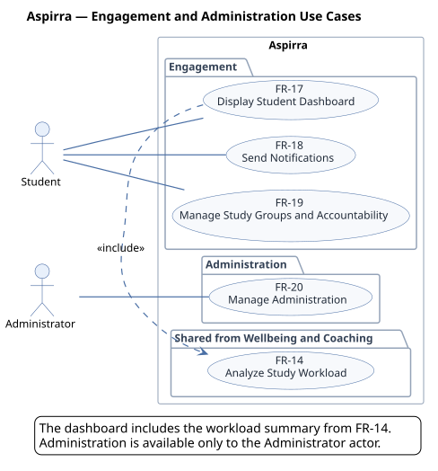

# B7 — Use case diagram

> Issue: #7 · Part: B · Owner: TBD · Reviewer: TBD · Status: Draft

## Content

### Diagram views

The use case model is split into an overview and five detail diagrams so that each part stays readable.

| View | Scope | PlantUML source |
|---|---|---|
| Overview | Actors and the five use-case domains | [`b7-use-case-overview.puml`](./assets/b7-use-case-overview.puml) |
| Academic records and goals | FR-01 to FR-05 | [`b7-use-case-academic-records.puml`](./assets/b7-use-case-academic-records.puml) |
| Study planning and adaptation | FR-06 to FR-08, with shared FR-14 and FR-15 | [`b7-use-case-study-planning.puml`](./assets/b7-use-case-study-planning.puml) |
| Career and portfolio | FR-09 to FR-12 | [`b7-use-case-career-portfolio.puml`](./assets/b7-use-case-career-portfolio.puml) |
| Wellbeing and coaching | FR-13 to FR-16 | [`b7-use-case-wellbeing-coaching.puml`](./assets/b7-use-case-wellbeing-coaching.puml) |
| Engagement and administration | FR-17 to FR-20, with shared FR-14 | [`b7-use-case-engagement-administration.puml`](./assets/b7-use-case-engagement-administration.puml) |

### Overview

### Academic records and goals

*AI goal planning is optional and extends manual academic-goal management.*

### Study planning and adaptation

*FR-14 and FR-15 are repeated here as shared use cases to show the adaptive-planning dependencies.*

### Career and portfolio

### Wellbeing and coaching

### Engagement and administration

*FR-14 is repeated here because the dashboard includes the workload summary.*

### Actors

| Actor | Type | Responsibility |
|---|---|---|
| Student | Primary | Manages academic work, plans, habits, career preparation, and collaboration features. |
| Administrator | Primary | Manages student accounts, platform statistics, account issues, and retention metrics. |
| AI Service | Secondary (external) | Generates goal roadmaps, study and adaptive plans, career roadmaps, skill-gap insights, predictions, and coaching recommendations. |

### Use cases

| ID | Use case | Primary actor | Supporting actor | Relationships |
|---|---|---|---|---|
| FR-01 | Manage Student Profile | Student | — | — |
| FR-02 | Manage Academic Goals | Student | — | Extended by FR-05 |
| FR-03 | Manage Courses | Student | — | — |
| FR-04 | Manage Assignments and Exams | Student | — | — |
| FR-05 | Plan Goals with AI | Student | AI Service | Extends FR-02 |
| FR-06 | Generate Study Plans | Student | AI Service | Includes FR-07; extended by FR-08 |
| FR-07 | Enable Smart Scheduling | Student | — | Included by FR-06 |
| FR-08 | Enable Adaptive Planning | Student | AI Service | Extends FR-06; includes FR-14 and FR-15 |
| FR-09 | Manage Career Roadmaps | Student | AI Service | — |
| FR-10 | Track Skills | Student | AI Service | — |
| FR-11 | Manage Projects and Portfolios | Student | — | — |
| FR-12 | Manage Internship and Job Preparation | Student | — | — |
| FR-13 | Manage Habits | Student | — | — |
| FR-14 | Analyze Study Workload | Student | — | Included by FR-08, FR-15, FR-16, and FR-17 |
| FR-15 | Predict and Warn Early | Student | AI Service | Includes FR-14; included by FR-08 |
| FR-16 | Coach Students with AI | Student | AI Service | Includes FR-14 |
| FR-17 | Display Student Dashboard | Student | — | Includes FR-14 |
| FR-18 | Send Notifications | Student | — | — |
| FR-19 | Manage Study Groups and Accountability | Student | — | — |
| FR-20 | Manage Administration | Administrator | — | — |

### Relationships

- **Extend:** AI goal planning extends manual academic-goal management, and adaptive planning extends the generated study plan.
- **Include:** Generating a study plan always schedules tasks; adaptive planning uses workload analysis and early warnings; prediction, coaching, and the dashboard all rely on workload analysis.

## Checklist

- [x] Identify actors
- [x] Derive use cases from the high-level FRs
- [x] Draw relationships (include/extend where relevant)
- [x] Export the diagrams to docs/proposal/assets/
