# Aspirra — Project Proposal

> **Course:** CSE454 — Advanced Software Engineering  
> **Institution:** Alamein International University  
> **Team:** SoftWave — Ahmed Mohamed Ahmed, Yomna Mohamed Fekry, Arwa Mohey Hamdy, Mostafa Khamis Abozead, Muhammed Hany Hamdy  
> **Date:** October 2026

## Overview

Aspirra is an AI-powered platform that turns a student's academic and career goals into a realistic, editable plan. It connects goals, courses, assignments, exams, study schedules, habits, skills, projects, and career preparation in one place, adapts the plan when the student falls behind, and warns about risks early — always with the student's approval before anything changes.

Study, habits, and career growth, all in one place.

## Contents

**Part A — Project Overview**

- A1 — Title, Description, Problem & Related Work
- A2 — Team Table

**Part B — Requirements & Design**

- B3 — Business & Customer Requirements
- B4 — Functional Requirements
- B5 — Non-Functional Requirements
- B6 — Subsystems, Interfaces & Traceability
- B7 — Use Case Diagram

**Part C — Planning & Management**

- C8 — Product Backlog
- C9 — Estimation & Sprint Plan
- C10 — PERT Estimation Error
- C11 — Jira Board
- C12 — GitHub Repository

**Part D — GUI Design**

- D13 — Figma GUI Screens

# Part A — Project Overview

The project title, description, problem statement, related work, and team information.

## A1 — Title, Description, Problem & Related Work

### Title & description

**Aspirra: Your AI Planner for Academic Success and Career Growth**

Every student has big goals, but turning them into daily action is the hard part. Aspirra is an AI-powered platform that makes it simple.

Share a goal like “reach a 3.5 GPA” or “land a software internship”, and Aspirra builds your roadmap of milestones, tasks, habits, and deadlines. You stay in control by editing the plan, and Aspirra fits it around your real schedule.

Life gets busy and plans slip. When yours does, Aspirra warns you early and recommends a way back on track, and nothing changes until you approve it. Along the way it tracks your skills, projects, and portfolio, so every study session moves you closer to your career.

Study, habits, and career growth, all in one place.

### The problem

Students don’t fail from a lack of ability. They fail because nothing connects their goals to their daily actions.

Deadlines sit in a calendar, tasks in a notes app, grades on the university portal, and career plans only in the student’s head. So goals stay too big to act on, schedules ignore real available time, and plans break when a single task is missed. Nobody warns the student early, and study stays disconnected from the skills and projects a career requires. The result is missed deadlines, lower grades, stress, and abandoned goals.

**What Aspirra solves**

Aspirra turns a goal into a realistic, editable plan, adapts it when the student falls behind, warns about risks early, and links daily study to career skills, all in one platform.

### Who suffers from it

University students are the people most affected, especially:

- **First-year students**, who are still learning to plan and are adjusting to the university workload.
- **Students with heavy workloads**, who juggle many courses, projects, and part-time work or activities.
- **Senior students**, who must balance coursework and graduation projects with portfolios and job applications.
- **Students who fall behind**, who have no easy way to recover once a plan breaks.

Instructors and academic advisors are affected indirectly, because they deal with late submissions and struggling students. They are not the main users of the system.

### Main features
|   # | Feature                        | Description                                                                                                      |
| --: | ------------------------------ | ---------------------------------------------------------------------------------------------------------------- |
|   1 | Student Profile                | Academic level, major, interests, skills, career interests, and availability.                                    |
|   2 | Academic Goal Management       | Semester goals, course goals, GPA targets, assignment goals, and exam goals.                                     |
|   3 | AI Goal Planner                | Convert a natural-language goal into milestones, tasks, habits, deadlines, and priorities.                       |
|   4 | AI Study Plan Generator        | Create personalized study plans and recommend adjustments based on progress and available time.                  |
|   5 | Course Management              | Manage courses, grades, assignments, projects, quizzes, exams, and course progress.                              |
|   6 | Assignment & Exam Planner      | Track deadlines, priorities, preparation schedules, and exam countdowns.                                         |
|   7 | Career Roadmap                 | Select a target career and track required skills, learning steps, and career progress.                           |
|   8 | Skill Tracking                 | Track technical and soft skills, skill levels, learning progress, and career skill requirements.                 |
|   9 | Project & Portfolio Management | Track projects, connect them to skills, and maintain a portfolio.                                                |
|  10 | Habit Management               | Track study, exercise, reading, coding, and other habits, including streaks and goal connections.                |
|  11 | Smart Scheduling               | Organize tasks using deadlines, priorities, workload, availability, and dependencies.                            |
|  12 | Adaptive Planning              | Detect when a student falls behind and recommend rescheduling or reprioritizing work.                            |
|  13 | AI Student Coach               | Provide personalized recommendations using the student's goals, tasks, habits, and progress.                     |
|  14 | Academic Performance Analytics | Show grade trends, course performance, study consistency, assignment completion, and GPA progress.               |
|  15 | Prediction & Early Warning     | Estimate goal completion and identify potential academic or deadline risks.                                      |
|  16 | Dashboard                      | Show today's tasks, upcoming deadlines, goal progress, habit streaks, academic performance, and career progress. |
|  17 | Notifications                  | Provide assignment, exam, study, missed-task, goal, and deadline reminders.                                      |
|  18 | Study Groups / Accountability  | Support shared goals, study groups, accountability partners, and shared progress.                                |
|  19 | Internship & Job Preparation   | Track applications, interview preparation, CV/portfolio progress, and required skills.                           |
|  20 | Admin Dashboard                | Support student management, system statistics, usage analytics, and activity monitoring.                         |

### Related work

| System      | Description                                                                                                                                                      | Limitations                                                                                                                                                                                                                                 |
| ----------- | ---------------------------------------------------------------------------------------------------------------------------------------------------------------- | ------------------------------------------------------------------------------------------------------------------------------------------------------------------------------------------------------------------------------------------- |
| Shovel      | A student planner where AI turns natural language into tasks, imports timetables, syncs calendars, checks if the schedule is realistic, and tracks study streaks | Plans only short-term study tasks. No long-term goal roadmap, no career or skill tracking, no study groups, no early-warning prediction. Paid subscription                                                                                  |
| MyStudyLife | A free planner for classes, assignments, and exams, with deadline reminders and a Pomodoro timer.                                                                | Mostly manual entry. No AI planning, no goal breakdown, no adaptive rescheduling, no career or skill features.                                                                                                                              |
| StudntX     | An AI assistant that builds study plans around the student’s schedule and tracks habits and streaks.                                                             | Focuses only on study plans and habits. No career roadmap, no skill or portfolio tracking, no analytics or early warning, no study groups.                                                                                                  |
| Reclaim.ai  | A web-based smart calendar that automatically blocks time for tasks and habits, and suggests a time-blocked day that the user approves or adjusts.               | Built as a general calendar, not for students. No course, grade, or exam tracking, no goal-to-plan breakdown, no career or skill features, no study groups. Its scheduling follows set rules rather than understanding the student’s goals. |

### Comparison table

| Feature                                                  | Shovel | MyStudyLife | StudntX | Reclaim.ai | Aspirra |
| -------------------------------------------------------- | ------ | ----------- | ------- | ---------- | ------- |
| Natural-language input to tasks                          | Yes    | No          | Yes     | No         | Yes     |
| Full goal roadmap (milestones, tasks, habits, deadlines) | No     | No          | Partial | No         | Yes     |
| Course, assignment, and exam tracking                    | Yes    | Yes         | Yes     | No         | Yes     |
| AI study plan around availability                        | Yes    | No          | Yes     | Partial    | Yes     |
| Schedule feasibility check                               | Yes    | No          | No      | No         | Yes     |
| Adaptive replanning when behind (student approves)       | No     | No          | No      | Partial    | Yes     |
| Habit tracking with streaks                              | Yes    | No          | Yes     | Partial    | Yes     |
| Deadline reminders                                       | Yes    | Yes         | Yes     | Yes        | Yes     |
| Career roadmap and skill tracking                        | No     | No          | No      | No         | Yes     |
| Project and portfolio management                         | No     | No          | No      | No         | Yes     |
| Prediction and early warning                             | No     | No          | No      | No         | Yes     |
| Study groups and accountability                          | No     | No          | No      | No         | Yes     |
| Admin dashboard                                          | No     | No          | No      | No         | Yes     |

## A2 — Team Table

| ID       | Name                   | University email                   | GitHub          | Services |
| -------- | ---------------------- | ---------------------------------- | --------------- | -------- |
| 23101359 | Ahmed Mohamed Ahmed    | ahmed.abdo.2024@aiu.edu.eg         | AbooSalh        | `student-service`, `academic-service`, `course-service`, `assessment-service` |
| 23101506 | Yomna Mohamed Fekry    | yomna.hosney.2024@aiu.edu.eg       | YomnaElmenawy   | `goal-planner-service`, `study-planner-service`, `scheduling-service`, `adaptation-service` |
| 23101371 | Arwa Mohey Hamdy       | arwa.hamdy.2024@aiu.edu.eg         | ArwaMohey       | `career-service`, `skill-service`, `portfolio-service`, `job-preparation-service` |
| 23101484 | Mostafa Khamis Abozead | mostafa.abozead.2024@aiu.edu.eg    | Mostafa-abozead | `habit-service`, `analytics-service`, `prediction-service`, `ai-coach-service` |
| 23102359 | Muhammed Hany Hamdy    | mohamed.abuaaliyah.2024@aiu.edu.eg | muhammedhanii   | `dashboard-service`, `notification-service`, `study-group-service`, `administration-service` |

# Part B — Requirements & Design

Business and customer requirements, functional and non-functional requirements, system decomposition, interfaces, traceability, and use cases.

## B3 — Business & Customer Requirements

### Business Requirements

| ID | Business Requirement |
|---|---|
| BR-01 | Reduce missed assignment and exam deadlines among active students by 30% within one semester of use. |
| BR-02 | Increase the number of active students who complete their semester goals by 25% within one semester of use. |
| BR-03 | Reduce the time students spend planning their study schedule by 50% within the first month of use. |
| BR-04 | Reach 1,000 registered students within 6 months of launch. |
| BR-05 | Increase the number of students who keep a study habit for at least 4 weeks in a row by 30% within one semester of use. |
| BR-06 | Have 60% of registered students set a target career and list their skills within 6 months of launch. |
| BR-07 | Reduce the time spent on student account support by 40% within one year of launch. |
| BR-08 | Keep at least 50% of registered students active every month within 6 months of launch. |

### Customer Requirements

#### User type 1: First-year students

| ID | Customer Requirement | Linked to |
|---|---|---|
| CR-01 | First-year students need to plan their courses and workload without any planning experience. | BR-03 |
| CR-02 | First-year students need to know what is due and when across all their courses. | BR-01 |
| CR-03 | First-year students need to build good study habits from the start. | BR-05 |

#### User type 2: Students with heavy workloads

| ID | Customer Requirement | Linked to |
|---|---|---|
| CR-04 | Students with heavy workloads need to fit courses, projects and part-time work into one realistic schedule. | BR-03 |
| CR-05 | Students with heavy workloads need to know what to do first when many deadlines collide. | BR-01 |
| CR-06 | Students with heavy workloads need to know early when their workload is too much to finish. | BR-02 |

#### User type 3: Senior students

| ID | Customer Requirement | Linked to |
|---|---|---|
| CR-07 | Senior students need to balance their graduation project and coursework with job preparation. | BR-02 |
| CR-08 | Senior students need to show their skills and projects to employers in one place. | BR-06 |
| CR-09 | Senior students need to know which skills they are missing for their target career. | BR-06 |

#### User type 4: Students who fall behind

| ID | Customer Requirement | Linked to |
|---|---|---|
| CR-10 | Students who fall behind need to be warned early, before a deadline is missed. | BR-01 |
| CR-11 | Students who fall behind need a clear way to recover after their plan breaks. | BR-02 |
| CR-12 | Students who fall behind need to stay motivated after missing tasks, with support from friends or study partners. | BR-08 |

#### User type 5: Administrator

| ID | Customer Requirement | Linked to |
|---|---|---|
| CR-13 | Admins need to manage student accounts without asking the developers. | BR-07 |
| CR-14 | Admins need to see how many students use the platform and how they use it. | BR-04 |
| CR-15 | Admins need to find and fix student account problems quickly. | BR-07 |
| CR-16 | Admins need to see how many students keep using the platform over time. | BR-08 |

## B4 — Functional Requirements

### High-level functional requirements

| ID | High-level FR (verb title) | Owner | Linked to |
|---|---|---|---|
| FR-01 | Manage Student Profile | Ahmed Mohamed Ahmed | CR-01 |
| FR-02 | Manage Academic Goals | Ahmed Mohamed Ahmed | CR-01, CR-02 |
| FR-03 | Manage Courses | Ahmed Mohamed Ahmed | CR-01, CR-02, CR-04 |
| FR-04 | Manage Assignments and Exams | Ahmed Mohamed Ahmed | CR-02, CR-04 |
| FR-05 | Plan Goals with AI | Yomna Mohamed Fekry | CR-01, CR-04 |
| FR-06 | Generate Study Plans | Yomna Mohamed Fekry | CR-01, CR-04, CR-06 |
| FR-07 | Enable Smart Scheduling | Yomna Mohamed Fekry | CR-04, CR-05 |
| FR-08 | Enable Adaptive Planning | Yomna Mohamed Fekry | CR-04, CR-05, CR-06, CR-11 |
| FR-09 | Manage Career Roadmaps | Arwa Mohey Hamdy | CR-07, CR-09 |
| FR-10 | Track Skills | Arwa Mohey Hamdy | CR-08, CR-09 |
| FR-11 | Manage Projects and Portfolios | Arwa Mohey Hamdy | CR-08 |
| FR-12 | Manage Internship and Job Preparation | Arwa Mohey Hamdy | CR-07, CR-08 |
| FR-13 | Manage Habits | Mostafa Khamis Abozead | CR-03 |
| FR-14 | Analyze Study Workload | Mostafa Khamis Abozead | CR-06 |
| FR-15 | Predict and Warn Early | Mostafa Khamis Abozead | CR-06, CR-10, CR-11 |
| FR-16 | Coach Students with AI | Mostafa Khamis Abozead | CR-06, CR-10, CR-11, CR-12 |
| FR-17 | Display Student Dashboard | Muhammed Hany Hamdy | CR-01, CR-02, CR-03, CR-06, CR-07 |
| FR-18 | Send Notifications | Muhammed Hany Hamdy | CR-02, CR-03, CR-04, CR-05, CR-10 |
| FR-19 | Manage Study Groups and Accountability | Muhammed Hany Hamdy | CR-12 |
| FR-20 | Manage Administration | Muhammed Hany Hamdy | CR-13, CR-14, CR-15, CR-16 |

### Low-level functional requirements

#### FR-01 — Manage Student Profile
**Owner:** Ahmed Mohamed Ahmed | **Linked to:** CR-01

| ID | Requirement | Owner | Linked to |
|---|---|---|---|
| FR-01.1 | The system shall allow a student to create a profile with academic level, major, interests, skills, career interests, and availability. | Ahmed Mohamed Ahmed | CR-01 |
| FR-01.2 | The system shall allow a student to update profile information including availability and career interests. | Ahmed Mohamed Ahmed | CR-01 |
| FR-01.3 | The system shall allow a student to view their complete profile details. | Ahmed Mohamed Ahmed | CR-01 |
| FR-01.4 | The system shall validate required profile fields before saving profile data. | Ahmed Mohamed Ahmed | CR-01 |

#### FR-02 — Manage Academic Goals
**Owner:** Ahmed Mohamed Ahmed | **Linked to:** CR-01, CR-02

| ID | Requirement | Owner | Linked to |
|---|---|---|---|
| FR-02.1 | The system shall allow a student to create an academic goal with a title, description, target date, and priority. | Ahmed Mohamed Ahmed | CR-01, CR-02 |
| FR-02.2 | The system shall allow a student to update the details of an existing academic goal. | Ahmed Mohamed Ahmed | CR-01 |
| FR-02.3 | The system shall allow a student to update the target date of an existing academic goal. | Ahmed Mohamed Ahmed | CR-02 |
| FR-02.4 | The system shall allow a student to mark an academic goal as completed. | Ahmed Mohamed Ahmed | CR-02 |
| FR-02.5 | The system shall allow a student to archive an academic goal. | Ahmed Mohamed Ahmed | CR-01 |
| FR-02.6 | The system shall allow a student to delete an academic goal they created. | Ahmed Mohamed Ahmed | CR-01 |

#### FR-03 — Manage Courses
**Owner:** Ahmed Mohamed Ahmed | **Linked to:** CR-01, CR-02, CR-04

| ID | Requirement | Owner | Linked to |
|---|---|---|---|
| FR-03.1 | The system shall allow a student to add a course with course name, course code, instructor, and semester details. | Ahmed Mohamed Ahmed | CR-01 |
| FR-03.2 | The system shall allow a student to record the credits and the weekly workload of each course. | Ahmed Mohamed Ahmed | CR-01, CR-04 |
| FR-03.3 | The system shall allow a student to view the progress of a course, including its completed and outstanding assignments. | Ahmed Mohamed Ahmed | CR-02, CR-04 |
| FR-03.4 | The system shall allow a student to update course information. | Ahmed Mohamed Ahmed | CR-01 |
| FR-03.5 | The system shall allow a student to remove a course. | Ahmed Mohamed Ahmed | CR-01 |

#### FR-04 — Manage Assignments and Exams
**Owner:** Ahmed Mohamed Ahmed | **Linked to:** CR-02, CR-04

| ID | Requirement | Owner | Linked to |
|---|---|---|---|
| FR-04.1 | The system shall allow a student to add an assignment with title, course, due date, priority, and description. | Ahmed Mohamed Ahmed | CR-02 |
| FR-04.2 | The system shall allow a student to add an exam with title, course, exam date, time, and location. | Ahmed Mohamed Ahmed | CR-02 |
| FR-04.3 | The system shall allow a student to track assignment status as not started, in progress, or completed. | Ahmed Mohamed Ahmed | CR-02, CR-04 |
| FR-04.4 | The system shall allow a student to set preparation reminders for upcoming exams. | Ahmed Mohamed Ahmed | CR-02 |

#### FR-05 — Plan Goals with AI
**Owner:** Yomna Mohamed Fekry | **Linked to:** CR-01, CR-04

| ID | Requirement | Owner | Linked to |
|---|---|---|---|
| FR-05.1 | The system shall allow a student to input a goal in natural language for AI processing. | Yomna Mohamed Fekry | CR-01 |
| FR-05.2 | The system shall generate a structured goal roadmap with milestones, tasks, and deadlines from natural language input. | Yomna Mohamed Fekry | CR-01 |
| FR-05.3 | The system shall allow a student to review AI-generated milestones and tasks before saving. | Yomna Mohamed Fekry | CR-04 |
| FR-05.4 | The system shall allow a student to edit AI-generated milestones before saving. | Yomna Mohamed Fekry | CR-04 |
| FR-05.5 | The system shall allow a student to edit AI-generated tasks before saving. | Yomna Mohamed Fekry | CR-04 |
| FR-05.6 | The system shall require student approval before applying AI-generated goals to their plan. | Yomna Mohamed Fekry | CR-04 |

#### FR-06 — Generate Study Plans
**Owner:** Yomna Mohamed Fekry | **Linked to:** CR-01, CR-04, CR-06

| ID | Requirement | Owner | Linked to |
|---|---|---|---|
| FR-06.1 | The system shall generate a personalized study plan based on courses, deadlines, and student availability. | Yomna Mohamed Fekry | CR-01, CR-04 |
| FR-06.2 | The system shall distribute study tasks across available time slots while respecting priorities. | Yomna Mohamed Fekry | CR-04 |
| FR-06.3 | The system shall allow a student to regenerate the study plan after an availability or deadline change. | Yomna Mohamed Fekry | CR-04, CR-06 |
| FR-06.4 | The system shall reject an AI-generated study plan that does not match the expected plan structure. | Yomna Mohamed Fekry | CR-04 |
| FR-06.5 | The system shall retain the previously saved study plan when an AI-generated plan is rejected. | Yomna Mohamed Fekry | CR-04 |

#### FR-07 — Enable Smart Scheduling
**Owner:** Yomna Mohamed Fekry | **Linked to:** CR-04, CR-05

| ID | Requirement | Owner | Linked to |
|---|---|---|---|
| FR-07.1 | The system shall schedule tasks based on deadlines, priorities, workload, availability, and dependencies. | Yomna Mohamed Fekry | CR-04 |
| FR-07.2 | The system shall detect scheduling conflicts between tasks and overlapping time slots. | Yomna Mohamed Fekry | CR-04 |
| FR-07.3 | The system shall suggest alternative time slots when scheduling conflicts occur. | Yomna Mohamed Fekry | CR-05 |
| FR-07.4 | The system shall allow a student to manually adjust scheduled tasks and times. | Yomna Mohamed Fekry | CR-04 |
| FR-07.5 | The system shall allow a student to mark a scheduled task as completed or not completed. | Yomna Mohamed Fekry | CR-04, CR-06 |

#### FR-08 — Enable Adaptive Planning
**Owner:** Yomna Mohamed Fekry | **Linked to:** CR-04, CR-05, CR-06, CR-11

| ID | Requirement | Owner | Linked to |
|---|---|---|---|
| FR-08.1 | The system shall detect when a student is falling behind on tasks or deadlines. | Yomna Mohamed Fekry | CR-06 |
| FR-08.2 | The system shall recommend rescheduling tasks when the student is behind schedule. | Yomna Mohamed Fekry | CR-04, CR-05 |
| FR-08.3 | The system shall recommend reprioritizing tasks when the student is behind schedule. | Yomna Mohamed Fekry | CR-05 |
| FR-08.4 | The system shall require student approval before applying adaptive plan changes. | Yomna Mohamed Fekry | CR-11 |
| FR-08.5 | The system shall allow a student to accept adaptive planning recommendations. | Yomna Mohamed Fekry | CR-11 |
| FR-08.6 | The system shall allow a student to reject adaptive planning recommendations. | Yomna Mohamed Fekry | CR-11 |
| FR-08.7 | The system shall allow a student to modify adaptive planning recommendations. | Yomna Mohamed Fekry | CR-11 |

#### FR-09 — Manage Career Roadmaps
**Owner:** Arwa Mohey Hamdy | **Linked to:** CR-07, CR-09

| ID | Requirement | Owner | Linked to |
|---|---|---|---|
| FR-09.1 | The system shall allow a student to select a target career from a predefined list. | Arwa Mohey Hamdy | CR-07 |
| FR-09.2 | The system shall allow a student to enter a custom target career. | Arwa Mohey Hamdy | CR-07 |
| FR-09.3 | The system shall generate a career roadmap with required skills, learning steps, and milestones. | Arwa Mohey Hamdy | CR-07 |
| FR-09.4 | The system shall allow a student to track progress toward completing career roadmap milestones. | Arwa Mohey Hamdy | CR-09 |
| FR-09.5 | The system shall allow a student to update their target career. | Arwa Mohey Hamdy | CR-09 |
| FR-09.6 | The system shall regenerate the career roadmap after the target career is updated. | Arwa Mohey Hamdy | CR-09 |

#### FR-10 — Track Skills
**Owner:** Arwa Mohey Hamdy | **Linked to:** CR-08, CR-09

| ID | Requirement | Owner | Linked to |
|---|---|---|---|
| FR-10.1 | The system shall allow a student to add technical and soft skills with current skill level. | Arwa Mohey Hamdy | CR-08 |
| FR-10.2 | The system shall compare a student's skills against the required skills of their target career. | Arwa Mohey Hamdy | CR-09 |
| FR-10.3 | The system shall identify skill gaps based on career requirements. | Arwa Mohey Hamdy | CR-09 |
| FR-10.4 | The system shall allow a student to update skill levels as they progress. | Arwa Mohey Hamdy | CR-09 |

#### FR-11 — Manage Projects and Portfolios
**Owner:** Arwa Mohey Hamdy | **Linked to:** CR-08

| ID | Requirement | Owner | Linked to |
|---|---|---|---|
| FR-11.1 | The system shall allow a student to add a project with title, description, technologies, and completion status. | Arwa Mohey Hamdy | CR-08 |
| FR-11.2 | The system shall allow a student to link projects to the skills they demonstrate. | Arwa Mohey Hamdy | CR-08 |
| FR-11.3 | The system shall generate a portfolio view of the student's completed projects. | Arwa Mohey Hamdy | CR-08 |
| FR-11.4 | The system shall allow a student to add project links and documentation to their portfolio. | Arwa Mohey Hamdy | CR-08 |

#### FR-12 — Manage Internship and Job Preparation
**Owner:** Arwa Mohey Hamdy | **Linked to:** CR-07, CR-08

| ID | Requirement | Owner | Linked to |
|---|---|---|---|
| FR-12.1 | The system shall allow a student to track internship and job applications with company, position, status, and deadline. | Arwa Mohey Hamdy | CR-07 |
| FR-12.2 | The system shall allow a student to track interview preparation tasks for each application. | Arwa Mohey Hamdy | CR-07 |
| FR-12.3 | The system shall allow a student to track CV updates related to applications. | Arwa Mohey Hamdy | CR-08 |
| FR-12.4 | The system shall allow a student to track portfolio updates related to applications. | Arwa Mohey Hamdy | CR-08 |
| FR-12.5 | The system shall allow a student to record the outcome of an application. | Arwa Mohey Hamdy | CR-07 |
| FR-12.6 | The system shall allow a student to record feedback received for an application. | Arwa Mohey Hamdy | CR-07 |

#### FR-13 — Manage Habits
**Owner:** Mostafa Khamis Abozead | **Linked to:** CR-03

| ID | Requirement | Owner | Linked to |
|---|---|---|---|
| FR-13.1 | The system shall allow a student to create a habit with name, frequency, goal, and reminder settings. | Mostafa Khamis Abozead | CR-03 |
| FR-13.2 | The system shall allow a student to mark a habit as completed for a scheduled day. | Mostafa Khamis Abozead | CR-03 |
| FR-13.3 | The system shall track habit streaks based on consecutive completions. | Mostafa Khamis Abozead | CR-03 |
| FR-13.4 | The system shall allow a student to link habits to academic goals. | Mostafa Khamis Abozead | CR-03 |

#### FR-14 — Analyze Study Workload
**Owner:** Mostafa Khamis Abozead | **Linked to:** CR-06

| ID | Requirement | Owner | Linked to |
|---|---|---|---|
| FR-14.1 | The system shall calculate the remaining workload of each active goal from its unfinished scheduled tasks and their scheduled durations. | Mostafa Khamis Abozead | CR-06 |
| FR-14.2 | The system shall calculate the remaining available study time of each active goal up to its target date, using the student's availability. | Mostafa Khamis Abozead | CR-06 |
| FR-14.3 | The system shall calculate the percentage of planned task duration completed for each active goal. | Mostafa Khamis Abozead | CR-06 |
| FR-14.4 | The system shall display the remaining workload, remaining available study time, and the percentage of planned task duration completed for each active goal. | Mostafa Khamis Abozead | CR-06 |
| FR-14.5 | The system shall mark an active goal as overloaded when its remaining workload exceeds its remaining available study time. | Mostafa Khamis Abozead | CR-06 |

#### FR-15 — Predict and Warn Early
**Owner:** Mostafa Khamis Abozead | **Linked to:** CR-06, CR-10, CR-11

| ID | Requirement | Owner | Linked to |
|---|---|---|---|
| FR-15.1 | The system shall estimate the likelihood of completing each active goal before its target date from its percentage of planned task duration completed and its remaining available study time. | Mostafa Khamis Abozead | CR-06 |
| FR-15.2 | The system shall generate an early warning for an active goal before its target date when the goal is marked as overloaded. | Mostafa Khamis Abozead | CR-06, CR-10 |
| FR-15.3 | The system shall identify which scheduled tasks of an active goal push its workload over its available study time. | Mostafa Khamis Abozead | CR-06, CR-10 |
| FR-15.4 | The system shall suggest recovery actions for a goal with an active early warning so the student can recover before the target date. | Mostafa Khamis Abozead | CR-11 |

#### FR-16 — Coach Students with AI
**Owner:** Mostafa Khamis Abozead | **Linked to:** CR-06, CR-10, CR-11, CR-12

| ID | Requirement | Owner | Linked to |
|---|---|---|---|
| FR-16.1 | The system shall provide personalized recommendations based on the student's goals, scheduled tasks, habits, and workload progress. | Mostafa Khamis Abozead | CR-06 |
| FR-16.2 | The system shall offer study advice tailored to upcoming deadlines and workload. | Mostafa Khamis Abozead | CR-06, CR-10 |
| FR-16.3 | The system shall suggest recovery strategies when a student falls behind their plan. | Mostafa Khamis Abozead | CR-11 |
| FR-16.4 | The system shall provide motivational guidance to help students stay on track with their goals. | Mostafa Khamis Abozead | CR-12 |

#### FR-17 — Display Student Dashboard
**Owner:** Muhammed Hany Hamdy | **Linked to:** CR-01, CR-02, CR-03, CR-06, CR-07

| ID | Requirement | Owner | Linked to |
|---|---|---|---|
| FR-17.1 | The system shall display today's tasks and upcoming deadlines on the student dashboard. | Muhammed Hany Hamdy | CR-02 |
| FR-17.2 | The system shall display the current status of each goal on the dashboard. | Muhammed Hany Hamdy | CR-02 |
| FR-17.3 | The system shall display the completion percentage of each goal on the dashboard. | Muhammed Hany Hamdy | CR-01, CR-02 |
| FR-17.4 | The system shall display habit streaks and completion status on the dashboard. | Muhammed Hany Hamdy | CR-03 |
| FR-17.5 | The system shall display the study workload summary of each active goal on the dashboard. | Muhammed Hany Hamdy | CR-06 |
| FR-17.6 | The system shall display career progress on the dashboard. | Muhammed Hany Hamdy | CR-07 |

#### FR-18 — Send Notifications
**Owner:** Muhammed Hany Hamdy | **Linked to:** CR-02, CR-03, CR-04, CR-05, CR-10

| ID | Requirement | Owner | Linked to |
|---|---|---|---|
| FR-18.1 | The system shall send reminders for upcoming assignments and exam deadlines. | Muhammed Hany Hamdy | CR-02 |
| FR-18.2 | The system shall send reminders for scheduled study tasks. | Muhammed Hany Hamdy | CR-04, CR-05 |
| FR-18.3 | The system shall send reminders for scheduled habits. | Muhammed Hany Hamdy | CR-03 |
| FR-18.4 | The system shall send early warning notifications when a student is at risk of missing deadlines. | Muhammed Hany Hamdy | CR-10 |
| FR-18.5 | The system shall send goal milestone reminders. | Muhammed Hany Hamdy | CR-02 |
| FR-18.6 | The system shall notify a student when a habit streak reaches a new milestone. | Muhammed Hany Hamdy | CR-03 |

#### FR-19 — Manage Study Groups and Accountability
**Owner:** Muhammed Hany Hamdy | **Linked to:** CR-12

| ID | Requirement | Owner | Linked to |
|---|---|---|---|
| FR-19.1 | The system shall allow a student to create a study group. | Muhammed Hany Hamdy | CR-12 |
| FR-19.2 | The system shall allow a student to join a study group. | Muhammed Hany Hamdy | CR-12 |
| FR-19.3 | The system shall allow study group members to share goals. | Muhammed Hany Hamdy | CR-12 |
| FR-19.4 | The system shall allow study group members to track group progress. | Muhammed Hany Hamdy | CR-12 |
| FR-19.5 | The system shall allow a student to find an accountability partner. | Muhammed Hany Hamdy | CR-12 |
| FR-19.6 | The system shall allow a student to connect with an accountability partner. | Muhammed Hany Hamdy | CR-12 |
| FR-19.7 | The system shall allow study groups to share progress updates. | Muhammed Hany Hamdy | CR-12 |
| FR-19.8 | The system shall allow study groups to share support messages. | Muhammed Hany Hamdy | CR-12 |

#### FR-20 — Manage Administration
**Owner:** Muhammed Hany Hamdy | **Linked to:** CR-13, CR-14, CR-15, CR-16

| ID | Requirement | Owner | Linked to |
|---|---|---|---|
| FR-20.1 | The system shall allow an administrator to view student account details. | Muhammed Hany Hamdy | CR-13 |
| FR-20.2 | The system shall allow an administrator to create a student account. | Muhammed Hany Hamdy | CR-13 |
| FR-20.3 | The system shall allow an administrator to update student account details. | Muhammed Hany Hamdy | CR-13 |
| FR-20.4 | The system shall allow an administrator to suspend a student account. | Muhammed Hany Hamdy | CR-13 |
| FR-20.5 | The system shall provide usage statistics showing the number of registered students. | Muhammed Hany Hamdy | CR-14 |
| FR-20.6 | The system shall provide usage statistics showing the number of active students. | Muhammed Hany Hamdy | CR-14 |
| FR-20.7 | The system shall provide usage statistics showing platform feature usage. | Muhammed Hany Hamdy | CR-14 |
| FR-20.8 | The system shall allow an administrator to investigate student account issues. | Muhammed Hany Hamdy | CR-15 |
| FR-20.9 | The system shall allow an administrator to resolve student account issues. | Muhammed Hany Hamdy | CR-15 |
| FR-20.10 | The system shall display platform retention metrics showing student activity over time. | Muhammed Hany Hamdy | CR-16 |

### Traceability Notes

- **FR-01**: Profile management (including availability, used by scheduling) is mapped to CR-01, the only documented need covering planning courses and workload.
- **FR-02**: Goal lifecycle is mapped to CR-01 (planning) and CR-02 (knowing what is due and when): creating a goal with a target date and priority maps to both, the target date and the completed state map to CR-02, and updating the details, archiving, and deleting map to CR-01. B3 has no CR dedicated to goal tracking, so CR-01 and CR-02 are the closest documented needs for these rows.
- **FR-03.2**: Narrowed to course credits and weekly workload, which are covered by CR-01 and CR-04. Grade recording was removed because no CR in B3 supports grades.
- **FR-03.3**: Course progress is mapped to CR-02 (outstanding assignments) and CR-04 (workload in one realistic schedule).
- **FR-04.3 / FR-04.4**: Assignment status tracking is mapped to CR-02 and CR-04; exam preparation reminders are mapped to CR-02, since CR-05 concerns prioritisation when deadlines collide.
- **FR-05**: Review, edit milestones, and edit tasks were split into FR-05.3, FR-05.4, and FR-05.5; the approval behaviour is FR-05.6. Review and edit are mapped to CR-04 because the student must be able to fit the AI proposal into a realistic schedule.
- **FR-06.1 / FR-06.3**: Plan generation is mapped to CR-01 and CR-04; regeneration after an availability or deadline change is also mapped to CR-06, since a changed workload may no longer be finishable.
- **FR-06.4 / FR-06.5**: Split into rejecting an invalid AI-generated plan and retaining the previously saved plan. Both are mapped to CR-04, because the student must keep a plan that still fits courses, projects, and work into one realistic schedule when a generation attempt fails.
- **FR-07**: Conflict resolution alternatives are mapped to CR-05 (knowing what to do first when deadlines collide); manual adjustment is mapped to CR-04 (fitting the work into one realistic schedule).
- **FR-08.2 / FR-08.3**: Rescheduling is mapped to CR-04 and CR-05; reprioritising is mapped to CR-05. Accept, reject, and modify are mapped to CR-11, the documented need for a clear way to recover after a plan breaks.
- **FR-09 / FR-10**: Career roadmap and skill work are mapped to CR-07 (balancing coursework with job preparation) and CR-09 (knowing which skills are missing for the target career). FR-10.1 is mapped to CR-08, since recorded skills are the content the student shows to employers in one place.
- **FR-11 / FR-12**: Projects, portfolio, CV, and portfolio updates are mapped to CR-08 (showing skills and projects to employers in one place); application tracking, interview preparation, outcomes, and feedback are mapped to CR-07 (job preparation).
- **FR-13.4**: Linking habits to academic goals is mapped to CR-03, the documented need to build good study habits from the start, so FR-13 is now linked to CR-03 only.
- **FR-14 (narrowed)**: Previously this FR covered grade trends, assignment completion rates, and GPA progress, which no CR in B3 supports. It is now **Analyze Study Workload**, defined only by the workload-planning need in CR-06 (knowing early when the workload is too much to finish): remaining workload, remaining available study time, the percentage of planned task duration completed, and the overloaded state.
- **FR-15**: Reworked around the same workload need. Early warnings are raised for goals already marked as overloaded, which is exactly the early warning CR-10 describes; recovery suggestions are mapped to CR-11.
- **FR-16.1 / FR-16.2**: Coaching recommendations and deadline-aware study advice are mapped to CR-06 and CR-10; recovery strategies to CR-11; motivational guidance to CR-12.
- **FR-17**: Renumbered after the splits. Today's tasks and upcoming deadlines are mapped to CR-02 (knowing what is due and when). FR-17.2 shows the current status of each goal, mapped to CR-02, because the status is read against the goal's target date. FR-17.3 shows the completion percentage of each goal, mapped to CR-01 (progress against the planned work) and CR-02 (progress against the goal's target date). As with FR-02, B3 has no CR dedicated to goal tracking, so CR-01 and CR-02 are the closest documented needs for these two rows. Habit streaks are mapped to CR-03 and career progress to CR-07. FR-17.5 previously showed an academic performance summary, which had no supporting CR; it now shows the study workload summary under CR-06.
- **FR-18**: Reminders for scheduled study tasks are mapped to CR-04 and CR-05; habit reminders and habit streak milestones to CR-03; deadline reminders to CR-02; early warning notifications to CR-10.
- **FR-19**: Creating and joining a study group, and finding and connecting with an accountability partner, were split into separate behaviours, all mapped to CR-12.
- **FR-20**: Account management is mapped to CR-13; issue investigation and resolution to CR-15; registered students, active students, and platform feature usage statistics to CR-14; retention metrics to CR-16.

### Scope notes

- Grade trends, assignment completion rates, GPA progress, and grade recording are **not** part of B4, because no Customer Requirement in B3 supports them. If the team wants these capabilities, a customer requirement must be added to B3 first, and FR-14 plus FR-17.5 can then be extended accordingly.
- Career, job-preparation, and study-group requirements are kept because the assignment requires four high-level FRs per member and the README assigns these areas to Members 3 and 5. They remain later-phase items against the suggested MVP and must be prioritised in the backlog (C8).

## B5 — Non-Functional Requirements

| ID | Category | Requirement | Conditions | How measured |
|---|---|---|---|---|
| NFR-01 | Performance | The API shall respond within **500 ms for at least 95% of ordinary non-AI API requests**. [Documented — README § Quality Attributes] | Release-candidate build in the team's test environment with a fixed dataset and authenticated sessions, under 50 concurrent virtual users for 10 minutes, excluding AI-provider calls. | **Method:** Scripted load test recording server-side response time per request as the 95th percentile; **Pass** when the 95th percentile is at or below 500 ms, **Fail** otherwise. |
| NFR-02 | Security | Every protected student-data endpoint shall require authentication and enforce authorization, with **zero unauthorized data access** to any student record, and administrator-only endpoints shall reject student accounts. [Documented — README § Quality Attributes] | Test environment seeded with two students and one administrator. Verify that missing, invalid, and non-owner student tokens are rejected, student accounts are denied access to administrator-only endpoints, and valid administrator access to administrator-only endpoints succeeds. | **Method:** Automated API-level integration tests, one per case, recording the actual result and whether another student's record was returned or changed; **Pass** when every case returns its expected result with no unauthorized access, **Fail** otherwise. |
| NFR-03 | Reliability | When an AI-provider request fails or returns schema-invalid output, the system shall **not lose, overwrite, or corrupt saved student data and shall not save a partial plan**, returning a defined error instead. [Documented — README § Quality Attributes] | Failure scenarios (provider error, rate limit, unavailable service, schema-invalid output) applied to both AI write paths, with the student's saved goal, study plan, and scheduled tasks snapshotted beforehand. | **Method:** Automated integration tests with the AI provider replaced by a test double, comparing the student's saved records before and after each failed request; **Pass** when every test returns a defined error and the saved records are unchanged, **Fail** otherwise. |
| NFR-04 | Usability | In a usability test, first-time students shall create a goal in natural language and review the AI-generated plan (milestones, tasks, and deadlines). Success targets: at least 4 of 5 participants finish within 5 minutes, with no more than 1 moderator intervention. [Task documented — README § Quality Attributes] | Moderated test of the running web frontend with 5 students who have not used Aspirra before, given only the task statement: enter a goal, then review the proposed plan, with the AI response stubbed and any moderator guidance beyond restating the task counted as an intervention. | **Method:** One timed, recorded session per participant, logging elapsed time, completion, and interventions; **Pass** when at least 4 of 5 participants finish within 5 minutes with no more than 1 intervention, **Fail** otherwise. |

## B6 — Subsystems, Interfaces & Traceability

### System decomposition (system → containers → components)

| Level | Element | Description |
|---|---|---|
| System | Aspirra | AI-powered student planning and career platform |
| Container | Web Frontend | Student and administrator web application (React / Next.js) |
| Container | Backend API | Application logic (ASP.NET Core); its components are the 10 subsystems below |
| Container | Relational Database | Stores the data of every subsystem |
| External system | External: AI Provider | LLM API used for goal planning, study plans, career roadmaps and coaching |
| External system | External: Email Service | Delivers reminders and warnings |

### Subsystems with their FRs

Each subsystem groups related high-level FRs. Each FR is one service, with its own feature branch in the repository and its own Jira label.

| ID | Subsystem | High-level FRs | Services |
|---|---|---|---|
| SUB-01 | Student Profile | FR-01 Manage Student Profile | student-service |
| SUB-02 | Academic Management | FR-02 Manage Academic Goals<br>FR-03 Manage Courses<br>FR-04 Manage Assignments and Exams | academic-service<br>course-service<br>assessment-service |
| SUB-03 | AI Planning & Scheduling | FR-05 Plan Goals with AI<br>FR-06 Generate Study Plans<br>FR-07 Enable Smart Scheduling<br>FR-08 Enable Adaptive Planning | goal-planner-service<br>study-planner-service<br>scheduling-service<br>adaptation-service |
| SUB-04 | Career Development | FR-09 Manage Career Roadmaps<br>FR-10 Track Skills<br>FR-11 Manage Projects and Portfolios<br>FR-12 Manage Internship and Job Preparation | career-service<br>skill-service<br>portfolio-service<br>job-preparation-service |
| SUB-05 | Habit Tracking | FR-13 Manage Habits | habit-service |
| SUB-06 | Insights & Coaching | FR-14 Analyze Study Workload<br>FR-15 Predict and Warn Early<br>FR-16 Coach Students with AI | analytics-service<br>prediction-service<br>ai-coach-service |
| SUB-07 | Student Dashboard | FR-17 Display Student Dashboard | dashboard-service |
| SUB-08 | Notifications | FR-18 Send Notifications | notification-service |
| SUB-09 | Study Groups & Accountability | FR-19 Manage Study Groups and Accountability | study-group-service |
| SUB-10 | Administration | FR-20 Manage Administration | administration-service |

### Interfaces

| Interface | Provided by | What it offers |
|---|---|---|
| IStudentProfile | SUB-01 Student Profile | Create, update and view the profile (FR-01); the student's availability and interests for other subsystems |
| IAcademic | SUB-02 Academic Management | Goals (FR-02), courses (FR-03), assignments, exams and their deadlines (FR-04) |
| IPlanning | SUB-03 AI Planning & Scheduling | AI goal plans (FR-05), study plans (FR-06), scheduled tasks and conflicts (FR-07), adaptive recommendations (FR-08) |
| ICareer | SUB-04 Career Development | Career roadmap and its progress (FR-09), skills and skill gaps (FR-10), projects and portfolio (FR-11), job applications (FR-12) |
| IHabit | SUB-05 Habit Tracking | Habits, completions and streaks (FR-13) |
| IInsights | SUB-06 Insights & Coaching | Workload per goal and overload state (FR-14), completion likelihood and early warnings (FR-15), coaching advice (FR-16) |
| IDashboard | SUB-07 Student Dashboard | The student dashboard view (FR-17) |
| INotification | SUB-08 Notifications | Reminders and notifications (FR-18) |
| IStudyGroup | SUB-09 Study Groups & Accountability | Groups, shared goals and progress, partners and messages (FR-19) |
| IAdministration | SUB-10 Administration | Account management, statistics and retention metrics (FR-20) |
| IAIProvider | External: AI Provider | Generates goal plans, study plans, career roadmaps and coaching text |
| IEmailGateway | External: Email Service | Sends emails |

### Traceability matrix

| Subsystem | High-level FRs | Provided interface | Required interfaces |
|---|---|---|---|
| SUB-01 Student Profile | FR-01 Manage Student Profile | IStudentProfile | — |
| SUB-02 Academic Management | FR-02 Manage Academic Goals, FR-03 Manage Courses, FR-04 Manage Assignments and Exams | IAcademic | IStudentProfile |
| SUB-03 AI Planning & Scheduling | FR-05 Plan Goals with AI, FR-06 Generate Study Plans, FR-07 Enable Smart Scheduling, FR-08 Enable Adaptive Planning | IPlanning | IStudentProfile, IAcademic, IAIProvider (External) |
| SUB-04 Career Development | FR-09 Manage Career Roadmaps, FR-10 Track Skills, FR-11 Manage Projects and Portfolios, FR-12 Manage Internship and Job Preparation | ICareer | IStudentProfile, IAIProvider (External) |
| SUB-05 Habit Tracking | FR-13 Manage Habits | IHabit | IAcademic |
| SUB-06 Insights & Coaching | FR-14 Analyze Study Workload, FR-15 Predict and Warn Early, FR-16 Coach Students with AI | IInsights | IStudentProfile, IAcademic, IPlanning, IHabit, IAIProvider (External) |
| SUB-07 Student Dashboard | FR-17 Display Student Dashboard | IDashboard | IAcademic, IPlanning, ICareer, IHabit, IInsights |
| SUB-08 Notifications | FR-18 Send Notifications | INotification | IAcademic, IPlanning, IHabit, IInsights, IEmailGateway (External) |
| SUB-09 Study Groups & Accountability | FR-19 Manage Study Groups and Accountability | IStudyGroup | IStudentProfile, IAcademic, IInsights |
| SUB-10 Administration | FR-20 Manage Administration | IAdministration | IStudentProfile |

## B7 — Use Case Diagram

### Diagram views

The use case model is split into an overview and five detail diagrams so that each part stays readable.

| View | Scope | PlantUML source |
|---|---|---|
| Overview | Actors and the five use-case domains | [`b7-use-case-overview.puml`](./assets/b7-use-case-overview.puml) |
| Academic records and goals | FR-01 to FR-05 | [`b7-use-case-academic-records.puml`](./assets/b7-use-case-academic-records.puml) |
| Study planning and adaptation | FR-06 to FR-08, with shared FR-14 and FR-15 | [`b7-use-case-study-planning.puml`](./assets/b7-use-case-study-planning.puml) |
| Career and portfolio | FR-09 to FR-12 | [`b7-use-case-career-portfolio.puml`](./assets/b7-use-case-career-portfolio.puml) |
| Wellbeing and coaching | FR-13 to FR-16 | [`b7-use-case-wellbeing-coaching.puml`](./assets/b7-use-case-wellbeing-coaching.puml) |
| Engagement and administration | FR-17 to FR-20, with shared FR-14 | [`b7-use-case-engagement-administration.puml`](./assets/b7-use-case-engagement-administration.puml) |

### Overview


### Academic records and goals


*AI goal planning is optional and extends manual academic-goal management.*

### Study planning and adaptation


*FR-14 and FR-15 are repeated here as shared use cases to show the adaptive-planning dependencies.*

### Career and portfolio


### Wellbeing and coaching


### Engagement and administration


*FR-14 is repeated here because the dashboard includes the workload summary.*

### Actors

| Actor | Type | Responsibility |
|---|---|---|
| Student | Primary | Manages academic work, plans, habits, career preparation, and collaboration features. |
| Administrator | Primary | Manages student accounts, platform statistics, account issues, and retention metrics. |
| AI Service | Secondary (external) | Generates goal roadmaps, study and adaptive plans, career roadmaps, skill-gap insights, predictions, and coaching recommendations. |
| Email Service | Secondary (external) | Delivers reminders, notifications, and early warnings. |

### Use cases

| ID | Use case | Primary actor | Supporting actor | Relationships |
|---|---|---|---|---|
| FR-01 | Manage Student Profile | Student | — | — |
| FR-02 | Manage Academic Goals | Student | — | Extended by FR-05 |
| FR-03 | Manage Courses | Student | — | — |
| FR-04 | Manage Assignments and Exams | Student | — | — |
| FR-05 | Plan Goals with AI | Student | AI Service | Extends FR-02 |
| FR-06 | Generate Study Plans | Student | AI Service | Includes FR-07; extended by FR-08 |
| FR-07 | Enable Smart Scheduling | Student | — | Included by FR-06 |
| FR-08 | Enable Adaptive Planning | Student | AI Service | Extends FR-06; includes FR-14 and FR-15 |
| FR-09 | Manage Career Roadmaps | Student | AI Service | — |
| FR-10 | Track Skills | Student | AI Service | — |
| FR-11 | Manage Projects and Portfolios | Student | — | — |
| FR-12 | Manage Internship and Job Preparation | Student | — | — |
| FR-13 | Manage Habits | Student | — | — |
| FR-14 | Analyze Study Workload | Student | — | Included by FR-08, FR-15, FR-16, and FR-17 |
| FR-15 | Predict and Warn Early | Student | AI Service | Includes FR-14; included by FR-08 |
| FR-16 | Coach Students with AI | Student | AI Service | Includes FR-14 |
| FR-17 | Display Student Dashboard | Student | — | Includes FR-14 |
| FR-18 | Send Notifications | Student | Email Service | — |
| FR-19 | Manage Study Groups and Accountability | Student | — | — |
| FR-20 | Manage Administration | Administrator | — | — |

### Relationships

- **Extend:** AI goal planning extends manual academic-goal management, and adaptive planning extends the generated study plan.
- **Include:** Generating a study plan always schedules tasks; adaptive planning uses workload analysis and early warnings; prediction, coaching, and the dashboard all rely on workload analysis.

# Part C — Planning & Management

Product backlog, estimates, sprint plan, PERT analysis, Jira board, and GitHub repository.

## C8 — Product Backlog

Each high-level FR is one feature (one epic in Jira), broken into user stories numbered under it as in the lab notation (FR-02 → US-02.1, US-02.2, …). **Covers** lists the low-level FRs each story implements; a low-level FR that is a system rule (e.g. FR-01.4 "validate required fields") is written as an acceptance criterion of its story. **Priority** (High = MVP, then Medium, then Low) is the order used in the sprint plan (C9).

### FR-01 — Manage Student Profile
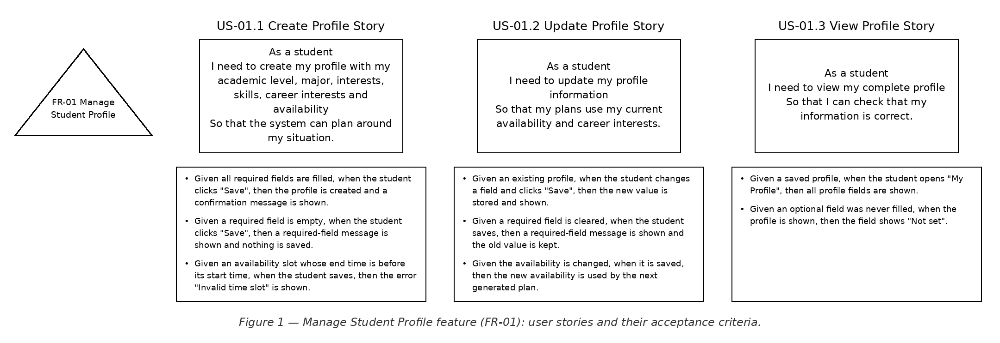

| Story | User story | Acceptance criteria | Covers | Priority |
|---|---|---|---|---|
| US-01.1 Create Profile Story | As a student, I need to create my profile with my academic level, major, interests, skills, career interests and availability, so that the system can plan around my situation. | • Given all required fields are filled, when the student clicks "Save", then the profile is created and a confirmation message is shown.<br>• Given a required field is empty, when the student clicks "Save", then a required-field message is shown and nothing is saved.<br>• Given an availability slot whose end time is before its start time, when the student saves, then the error "Invalid time slot" is shown. | FR-01.1, FR-01.4 | High |
| US-01.2 Update Profile Story | As a student, I need to update my profile information, so that my plans use my current availability and career interests. | • Given an existing profile, when the student changes a field and clicks "Save", then the new value is stored and shown.<br>• Given a required field is cleared, when the student saves, then a required-field message is shown and the old value is kept.<br>• Given the availability is changed, when it is saved, then the new availability is used by the next generated plan. | FR-01.2, FR-01.4 | High |
| US-01.3 View Profile Story | As a student, I need to view my complete profile, so that I can check that my information is correct. | • Given a saved profile, when the student opens "My Profile", then all profile fields are shown.<br>• Given an optional field was never filled, when the profile is shown, then the field shows "Not set". | FR-01.3 | High |

### FR-02 — Manage Academic Goals
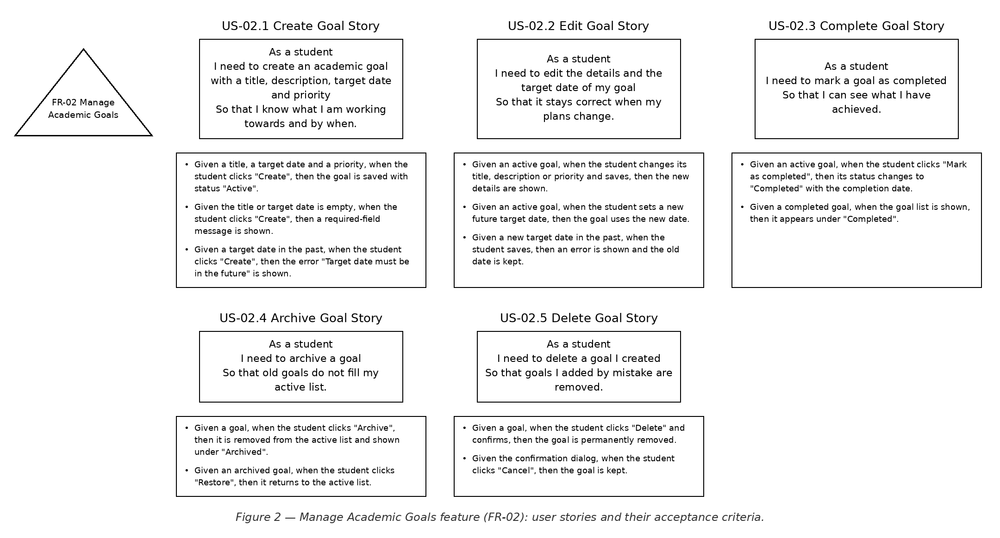

| Story | User story | Acceptance criteria | Covers | Priority |
|---|---|---|---|---|
| US-02.1 Create Goal Story | As a student, I need to create an academic goal with a title, description, target date and priority, so that I know what I am working towards and by when. | • Given a title, a target date and a priority, when the student clicks "Create", then the goal is saved with status "Active".<br>• Given the title or target date is empty, when the student clicks "Create", then a required-field message is shown.<br>• Given a target date in the past, when the student clicks "Create", then the error "Target date must be in the future" is shown. | FR-02.1 | High |
| US-02.2 Edit Goal Story | As a student, I need to edit the details and the target date of my goal, so that it stays correct when my plans change. | • Given an active goal, when the student changes its title, description or priority and saves, then the new details are shown.<br>• Given an active goal, when the student sets a new future target date, then the goal uses the new date.<br>• Given a new target date in the past, when the student saves, then an error is shown and the old date is kept. | FR-02.2, FR-02.3 | High |
| US-02.3 Complete Goal Story | As a student, I need to mark a goal as completed, so that I can see what I have achieved. | • Given an active goal, when the student clicks "Mark as completed", then its status changes to "Completed" with the completion date.<br>• Given a completed goal, when the goal list is shown, then it appears under "Completed". | FR-02.4 | High |
| US-02.4 Archive Goal Story | As a student, I need to archive a goal, so that old goals do not fill my active list. | • Given a goal, when the student clicks "Archive", then it is removed from the active list and shown under "Archived".<br>• Given an archived goal, when the student clicks "Restore", then it returns to the active list. | FR-02.5 | Medium |
| US-02.5 Delete Goal Story | As a student, I need to delete a goal I created, so that goals I added by mistake are removed. | • Given a goal, when the student clicks "Delete" and confirms, then the goal is permanently removed.<br>• Given the confirmation dialog, when the student clicks "Cancel", then the goal is kept. | FR-02.6 | Medium |

### FR-03 — Manage Courses
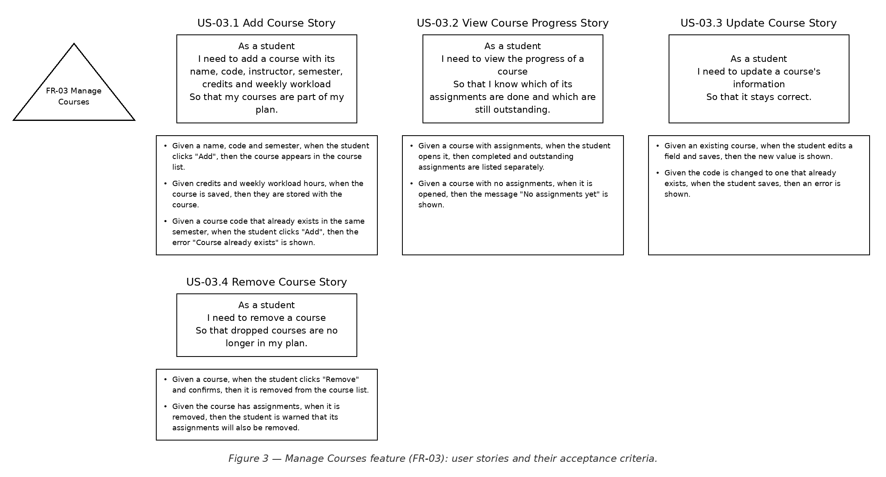

| Story | User story | Acceptance criteria | Covers | Priority |
|---|---|---|---|---|
| US-03.1 Add Course Story | As a student, I need to add a course with its name, code, instructor, semester, credits and weekly workload, so that my courses are part of my plan. | • Given a name, code and semester, when the student clicks "Add", then the course appears in the course list.<br>• Given credits and weekly workload hours, when the course is saved, then they are stored with the course.<br>• Given a course code that already exists in the same semester, when the student clicks "Add", then the error "Course already exists" is shown. | FR-03.1, FR-03.2 | High |
| US-03.2 View Course Progress Story | As a student, I need to view the progress of a course, so that I know which of its assignments are done and which are still outstanding. | • Given a course with assignments, when the student opens it, then completed and outstanding assignments are listed separately.<br>• Given a course with no assignments, when it is opened, then the message "No assignments yet" is shown. | FR-03.3 | High |
| US-03.3 Update Course Story | As a student, I need to update a course's information, so that it stays correct. | • Given an existing course, when the student edits a field and saves, then the new value is shown.<br>• Given the code is changed to one that already exists, when the student saves, then an error is shown. | FR-03.4 | Medium |
| US-03.4 Remove Course Story | As a student, I need to remove a course, so that dropped courses are no longer in my plan. | • Given a course, when the student clicks "Remove" and confirms, then it is removed from the course list.<br>• Given the course has assignments, when it is removed, then the student is warned that its assignments will also be removed. | FR-03.5 | Medium |

### FR-04 — Manage Assignments and Exams
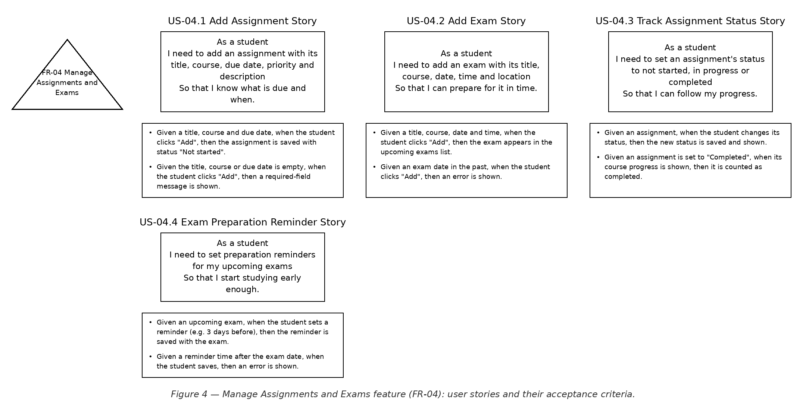

| Story | User story | Acceptance criteria | Covers | Priority |
|---|---|---|---|---|
| US-04.1 Add Assignment Story | As a student, I need to add an assignment with its title, course, due date, priority and description, so that I know what is due and when. | • Given a title, course and due date, when the student clicks "Add", then the assignment is saved with status "Not started".<br>• Given the title, course or due date is empty, when the student clicks "Add", then a required-field message is shown. | FR-04.1 | High |
| US-04.2 Add Exam Story | As a student, I need to add an exam with its title, course, date, time and location, so that I can prepare for it in time. | • Given a title, course, date and time, when the student clicks "Add", then the exam appears in the upcoming exams list.<br>• Given an exam date in the past, when the student clicks "Add", then an error is shown. | FR-04.2 | High |
| US-04.3 Track Assignment Status Story | As a student, I need to set an assignment's status to not started, in progress or completed, so that I can follow my progress. | • Given an assignment, when the student changes its status, then the new status is saved and shown.<br>• Given an assignment is set to "Completed", when its course progress is shown, then it is counted as completed. | FR-04.3 | High |
| US-04.4 Exam Preparation Reminder Story | As a student, I need to set preparation reminders for my upcoming exams, so that I start studying early enough. | • Given an upcoming exam, when the student sets a reminder (e.g. 3 days before), then the reminder is saved with the exam.<br>• Given a reminder time after the exam date, when the student saves, then an error is shown. | FR-04.4 | Medium |

### FR-05 — Plan Goals with AI
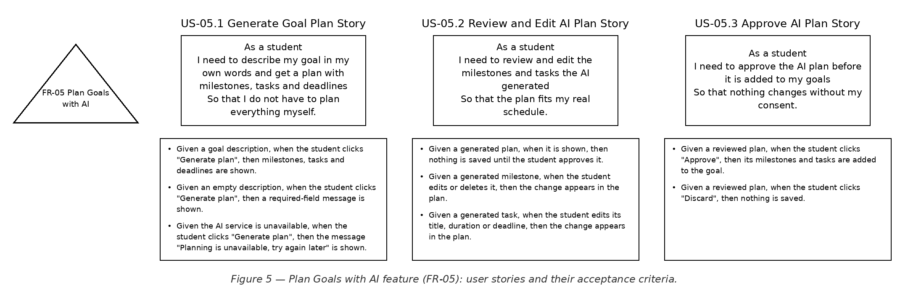

| Story | User story | Acceptance criteria | Covers | Priority |
|---|---|---|---|---|
| US-05.1 Generate Goal Plan Story | As a student, I need to describe my goal in my own words and get a plan with milestones, tasks and deadlines, so that I do not have to plan everything myself. | • Given a goal description, when the student clicks "Generate plan", then milestones, tasks and deadlines are shown.<br>• Given an empty description, when the student clicks "Generate plan", then a required-field message is shown.<br>• Given the AI service is unavailable, when the student clicks "Generate plan", then the message "Planning is unavailable, try again later" is shown. | FR-05.1, FR-05.2 | High |
| US-05.2 Review and Edit AI Plan Story | As a student, I need to review and edit the milestones and tasks the AI generated, so that the plan fits my real schedule. | • Given a generated plan, when it is shown, then nothing is saved until the student approves it.<br>• Given a generated milestone, when the student edits or deletes it, then the change appears in the plan.<br>• Given a generated task, when the student edits its title, duration or deadline, then the change appears in the plan. | FR-05.3, FR-05.4, FR-05.5 | High |
| US-05.3 Approve AI Plan Story | As a student, I need to approve the AI plan before it is added to my goals, so that nothing changes without my consent. | • Given a reviewed plan, when the student clicks "Approve", then its milestones and tasks are added to the goal.<br>• Given a reviewed plan, when the student clicks "Discard", then nothing is saved. | FR-05.6 | High |

### FR-06 — Generate Study Plans
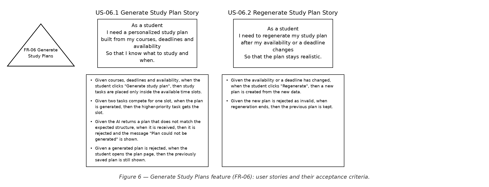

| Story | User story | Acceptance criteria | Covers | Priority |
|---|---|---|---|---|
| US-06.1 Generate Study Plan Story | As a student, I need a personalized study plan built from my courses, deadlines and availability, so that I know what to study and when. | • Given courses, deadlines and availability, when the student clicks "Generate study plan", then study tasks are placed only inside the available time slots.<br>• Given two tasks compete for one slot, when the plan is generated, then the higher-priority task gets the slot.<br>• Given the AI returns a plan that does not match the expected structure, when it is received, then it is rejected and the message "Plan could not be generated" is shown.<br>• Given a generated plan is rejected, when the student opens the plan page, then the previously saved plan is still shown. | FR-06.1, FR-06.2, FR-06.4, FR-06.5 | High |
| US-06.2 Regenerate Study Plan Story | As a student, I need to regenerate my study plan after my availability or a deadline changes, so that the plan stays realistic. | • Given the availability or a deadline has changed, when the student clicks "Regenerate", then a new plan is created from the new data.<br>• Given the new plan is rejected as invalid, when regeneration ends, then the previous plan is kept. | FR-06.3 | Medium |

### FR-07 — Enable Smart Scheduling
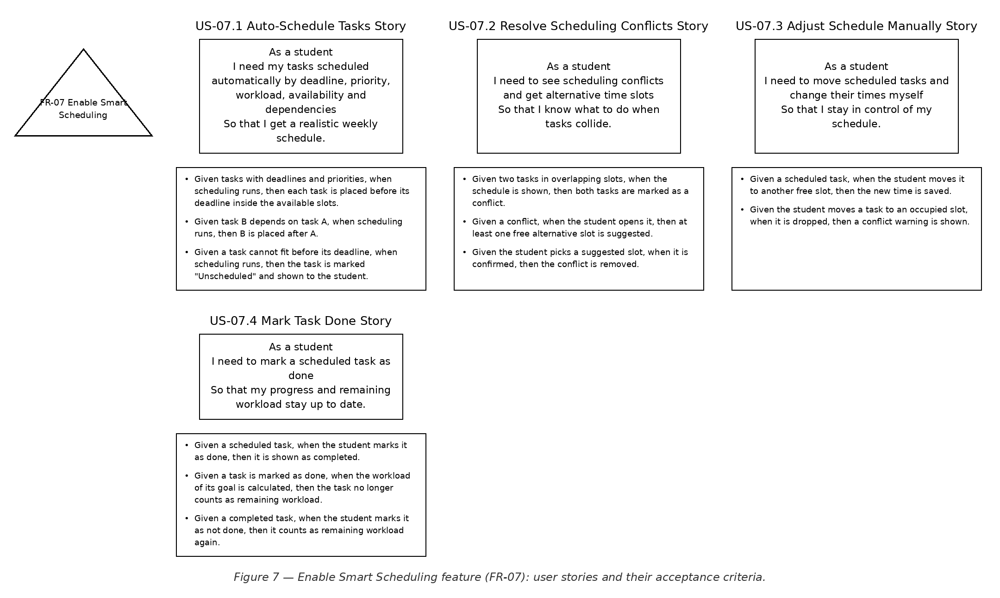

| Story | User story | Acceptance criteria | Covers | Priority |
|---|---|---|---|---|
| US-07.1 Auto-Schedule Tasks Story | As a student, I need my tasks scheduled automatically by deadline, priority, workload, availability and dependencies, so that I get a realistic weekly schedule. | • Given tasks with deadlines and priorities, when scheduling runs, then each task is placed before its deadline inside the available slots.<br>• Given task B depends on task A, when scheduling runs, then B is placed after A.<br>• Given a task cannot fit before its deadline, when scheduling runs, then the task is marked "Unscheduled" and shown to the student. | FR-07.1 | High |
| US-07.2 Resolve Scheduling Conflicts Story | As a student, I need to see scheduling conflicts and get alternative time slots, so that I know what to do when tasks collide. | • Given two tasks in overlapping slots, when the schedule is shown, then both tasks are marked as a conflict.<br>• Given a conflict, when the student opens it, then at least one free alternative slot is suggested.<br>• Given the student picks a suggested slot, when it is confirmed, then the conflict is removed. | FR-07.2, FR-07.3 | High |
| US-07.3 Adjust Schedule Manually Story | As a student, I need to move scheduled tasks and change their times myself, so that I stay in control of my schedule. | • Given a scheduled task, when the student moves it to another free slot, then the new time is saved.<br>• Given the student moves a task to an occupied slot, when it is dropped, then a conflict warning is shown. | FR-07.4 | Medium |
| US-07.4 Mark Task Done Story | As a student, I need to mark a scheduled task as done, so that my progress and remaining workload stay up to date. | • Given a scheduled task, when the student marks it as done, then it is shown as completed.<br>• Given a task is marked as done, when the workload of its goal is calculated, then the task no longer counts as remaining workload.<br>• Given a completed task, when the student marks it as not done, then it counts as remaining workload again. | FR-07.5 | High |

### FR-08 — Enable Adaptive Planning
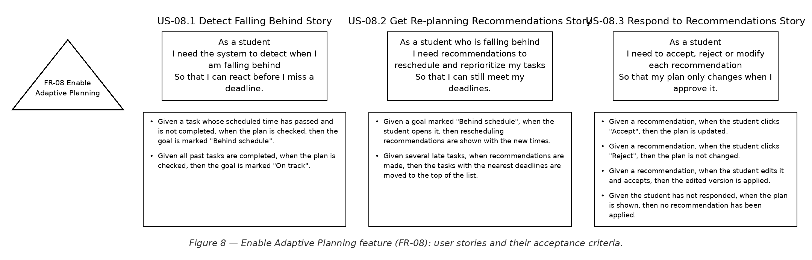

| Story | User story | Acceptance criteria | Covers | Priority |
|---|---|---|---|---|
| US-08.1 Detect Falling Behind Story | As a student, I need the system to detect when I am falling behind, so that I can react before I miss a deadline. | • Given a task whose scheduled time has passed and is not completed, when the plan is checked, then the goal is marked "Behind schedule".<br>• Given all past tasks are completed, when the plan is checked, then the goal is marked "On track". | FR-08.1 | High |
| US-08.2 Get Re-planning Recommendations Story | As a student who is falling behind, I need recommendations to reschedule and reprioritize my tasks, so that I can still meet my deadlines. | • Given a goal marked "Behind schedule", when the student opens it, then rescheduling recommendations are shown with the new times.<br>• Given several late tasks, when recommendations are made, then the tasks with the nearest deadlines are moved to the top of the list. | FR-08.2, FR-08.3 | Medium |
| US-08.3 Respond to Recommendations Story | As a student, I need to accept, reject or modify each recommendation, so that my plan only changes when I approve it. | • Given a recommendation, when the student clicks "Accept", then the plan is updated.<br>• Given a recommendation, when the student clicks "Reject", then the plan is not changed.<br>• Given a recommendation, when the student edits it and accepts, then the edited version is applied.<br>• Given the student has not responded, when the plan is shown, then no recommendation has been applied. | FR-08.4, FR-08.5, FR-08.6, FR-08.7 | Medium |

### FR-09 — Manage Career Roadmaps
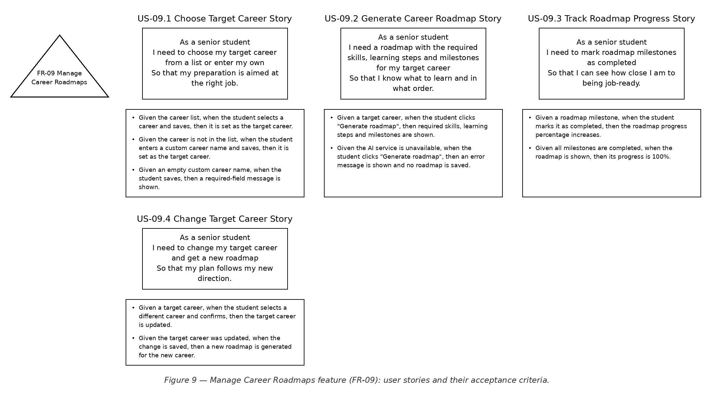

| Story | User story | Acceptance criteria | Covers | Priority |
|---|---|---|---|---|
| US-09.1 Choose Target Career Story | As a senior student, I need to choose my target career from a list or enter my own, so that my preparation is aimed at the right job. | • Given the career list, when the student selects a career and saves, then it is set as the target career.<br>• Given the career is not in the list, when the student enters a custom career name and saves, then it is set as the target career.<br>• Given an empty custom career name, when the student saves, then a required-field message is shown. | FR-09.1, FR-09.2 | Low |
| US-09.2 Generate Career Roadmap Story | As a senior student, I need a roadmap with the required skills, learning steps and milestones for my target career, so that I know what to learn and in what order. | • Given a target career, when the student clicks "Generate roadmap", then required skills, learning steps and milestones are shown.<br>• Given the AI service is unavailable, when the student clicks "Generate roadmap", then an error message is shown and no roadmap is saved. | FR-09.3 | Low |
| US-09.3 Track Roadmap Progress Story | As a senior student, I need to mark roadmap milestones as completed, so that I can see how close I am to being job-ready. | • Given a roadmap milestone, when the student marks it as completed, then the roadmap progress percentage increases.<br>• Given all milestones are completed, when the roadmap is shown, then its progress is 100%. | FR-09.4 | Low |
| US-09.4 Change Target Career Story | As a senior student, I need to change my target career and get a new roadmap, so that my plan follows my new direction. | • Given a target career, when the student selects a different career and confirms, then the target career is updated.<br>• Given the target career was updated, when the change is saved, then a new roadmap is generated for the new career. | FR-09.5, FR-09.6 | Low |

### FR-10 — Track Skills
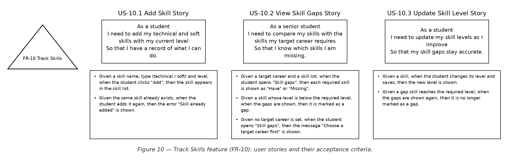

| Story | User story | Acceptance criteria | Covers | Priority |
|---|---|---|---|---|
| US-10.1 Add Skill Story | As a student, I need to add my technical and soft skills with my current level, so that I have a record of what I can do. | • Given a skill name, type (technical / soft) and level, when the student clicks "Add", then the skill appears in the skill list.<br>• Given the same skill already exists, when the student adds it again, then the error "Skill already added" is shown. | FR-10.1 | Low |
| US-10.2 View Skill Gaps Story | As a senior student, I need to compare my skills with the skills my target career requires, so that I know which skills I am missing. | • Given a target career and a skill list, when the student opens "Skill gaps", then each required skill is shown as "Have" or "Missing".<br>• Given a skill whose level is below the required level, when the gaps are shown, then it is marked as a gap.<br>• Given no target career is set, when the student opens "Skill gaps", then the message "Choose a target career first" is shown. | FR-10.2, FR-10.3 | Low |
| US-10.3 Update Skill Level Story | As a student, I need to update my skill levels as I improve, so that my skill gaps stay accurate. | • Given a skill, when the student changes its level and saves, then the new level is shown.<br>• Given a gap skill reaches the required level, when the gaps are shown again, then it is no longer marked as a gap. | FR-10.4 | Low |

### FR-11 — Manage Projects and Portfolios
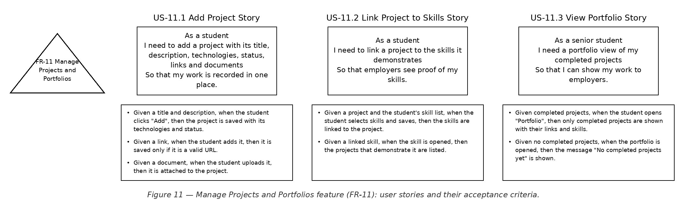

| Story | User story | Acceptance criteria | Covers | Priority |
|---|---|---|---|---|
| US-11.1 Add Project Story | As a student, I need to add a project with its title, description, technologies, status, links and documents, so that my work is recorded in one place. | • Given a title and description, when the student clicks "Add", then the project is saved with its technologies and status.<br>• Given a link, when the student adds it, then it is saved only if it is a valid URL.<br>• Given a document, when the student uploads it, then it is attached to the project. | FR-11.1, FR-11.4 | Low |
| US-11.2 Link Project to Skills Story | As a student, I need to link a project to the skills it demonstrates, so that employers see proof of my skills. | • Given a project and the student's skill list, when the student selects skills and saves, then the skills are linked to the project.<br>• Given a linked skill, when the skill is opened, then the projects that demonstrate it are listed. | FR-11.2 | Low |
| US-11.3 View Portfolio Story | As a senior student, I need a portfolio view of my completed projects, so that I can show my work to employers. | • Given completed projects, when the student opens "Portfolio", then only completed projects are shown with their links and skills.<br>• Given no completed projects, when the portfolio is opened, then the message "No completed projects yet" is shown. | FR-11.3 | Low |

### FR-12 — Manage Internship and Job Preparation
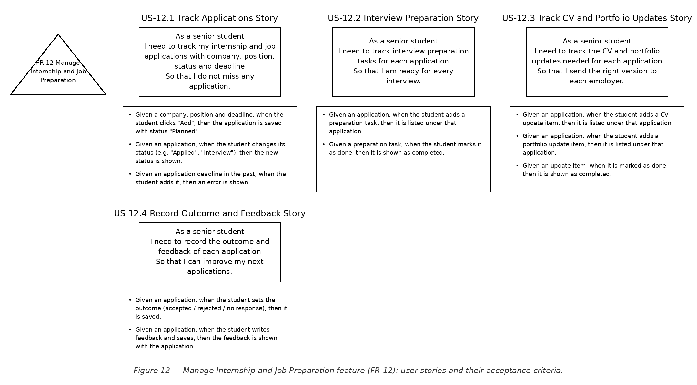

| Story | User story | Acceptance criteria | Covers | Priority |
|---|---|---|---|---|
| US-12.1 Track Applications Story | As a senior student, I need to track my internship and job applications with company, position, status and deadline, so that I do not miss any application. | • Given a company, position and deadline, when the student clicks "Add", then the application is saved with status "Planned".<br>• Given an application, when the student changes its status (e.g. "Applied", "Interview"), then the new status is shown.<br>• Given an application deadline in the past, when the student adds it, then an error is shown. | FR-12.1 | Low |
| US-12.2 Interview Preparation Story | As a senior student, I need to track interview preparation tasks for each application, so that I am ready for every interview. | • Given an application, when the student adds a preparation task, then it is listed under that application.<br>• Given a preparation task, when the student marks it as done, then it is shown as completed. | FR-12.2 | Low |
| US-12.3 Track CV and Portfolio Updates Story | As a senior student, I need to track the CV and portfolio updates needed for each application, so that I send the right version to each employer. | • Given an application, when the student adds a CV update item, then it is listed under that application.<br>• Given an application, when the student adds a portfolio update item, then it is listed under that application.<br>• Given an update item, when it is marked as done, then it is shown as completed. | FR-12.3, FR-12.4 | Low |
| US-12.4 Record Outcome and Feedback Story | As a senior student, I need to record the outcome and feedback of each application, so that I can improve my next applications. | • Given an application, when the student sets the outcome (accepted / rejected / no response), then it is saved.<br>• Given an application, when the student writes feedback and saves, then the feedback is shown with the application. | FR-12.5, FR-12.6 | Low |

### FR-13 — Manage Habits
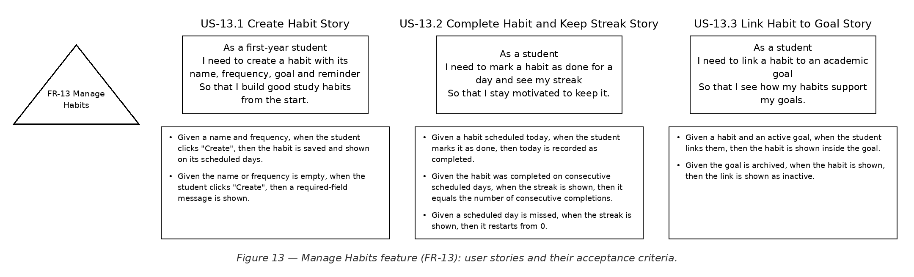

| Story | User story | Acceptance criteria | Covers | Priority |
|---|---|---|---|---|
| US-13.1 Create Habit Story | As a first-year student, I need to create a habit with its name, frequency, goal and reminder, so that I build good study habits from the start. | • Given a name and frequency, when the student clicks "Create", then the habit is saved and shown on its scheduled days.<br>• Given the name or frequency is empty, when the student clicks "Create", then a required-field message is shown. | FR-13.1 | High |
| US-13.2 Complete Habit and Keep Streak Story | As a student, I need to mark a habit as done for a day and see my streak, so that I stay motivated to keep it. | • Given a habit scheduled today, when the student marks it as done, then today is recorded as completed.<br>• Given the habit was completed on consecutive scheduled days, when the streak is shown, then it equals the number of consecutive completions.<br>• Given a scheduled day is missed, when the streak is shown, then it restarts from 0. | FR-13.2, FR-13.3 | High |
| US-13.3 Link Habit to Goal Story | As a student, I need to link a habit to an academic goal, so that I see how my habits support my goals. | • Given a habit and an active goal, when the student links them, then the habit is shown inside the goal.<br>• Given the goal is archived, when the habit is shown, then the link is shown as inactive. | FR-13.4 | Medium |

### FR-14 — Analyze Study Workload
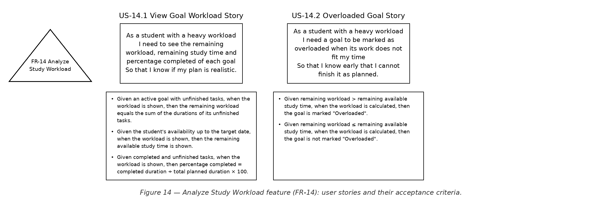

| Story | User story | Acceptance criteria | Covers | Priority |
|---|---|---|---|---|
| US-14.1 View Goal Workload Story | As a student with a heavy workload, I need to see the remaining workload, remaining study time and percentage completed of each goal, so that I know if my plan is realistic. | • Given an active goal with unfinished tasks, when the workload is shown, then the remaining workload equals the sum of the durations of its unfinished tasks.<br>• Given the student's availability up to the target date, when the workload is shown, then the remaining available study time is shown.<br>• Given completed and unfinished tasks, when the workload is shown, then percentage completed = completed duration ÷ total planned duration × 100. | FR-14.1, FR-14.2, FR-14.3, FR-14.4 | Medium |
| US-14.2 Overloaded Goal Story | As a student with a heavy workload, I need a goal to be marked as overloaded when its work does not fit my time, so that I know early that I cannot finish it as planned. | • Given remaining workload > remaining available study time, when the workload is calculated, then the goal is marked "Overloaded".<br>• Given remaining workload ≤ remaining available study time, when the workload is calculated, then the goal is not marked "Overloaded". | FR-14.5 | Medium |

### FR-15 — Predict and Warn Early
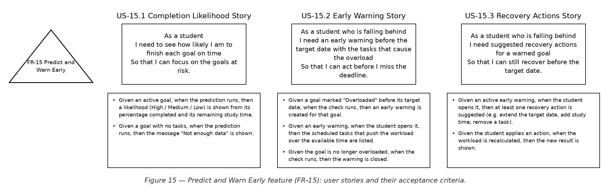

| Story | User story | Acceptance criteria | Covers | Priority |
|---|---|---|---|---|
| US-15.1 Completion Likelihood Story | As a student, I need to see how likely I am to finish each goal on time, so that I can focus on the goals at risk. | • Given an active goal, when the prediction runs, then a likelihood (High / Medium / Low) is shown from its percentage completed and its remaining study time.<br>• Given a goal with no tasks, when the prediction runs, then the message "Not enough data" is shown. | FR-15.1 | Medium |
| US-15.2 Early Warning Story | As a student who is falling behind, I need an early warning before the target date with the tasks that cause the overload, so that I can act before I miss the deadline. | • Given a goal marked "Overloaded" before its target date, when the check runs, then an early warning is created for that goal.<br>• Given an early warning, when the student opens it, then the scheduled tasks that push the workload over the available time are listed.<br>• Given the goal is no longer overloaded, when the check runs, then the warning is closed. | FR-15.2, FR-15.3 | Medium |
| US-15.3 Recovery Actions Story | As a student who is falling behind, I need suggested recovery actions for a warned goal, so that I can still recover before the target date. | • Given an active early warning, when the student opens it, then at least one recovery action is suggested (e.g. extend the target date, add study time, remove a task).<br>• Given the student applies an action, when the workload is recalculated, then the new result is shown. | FR-15.4 | Medium |

### FR-16 — Coach Students with AI
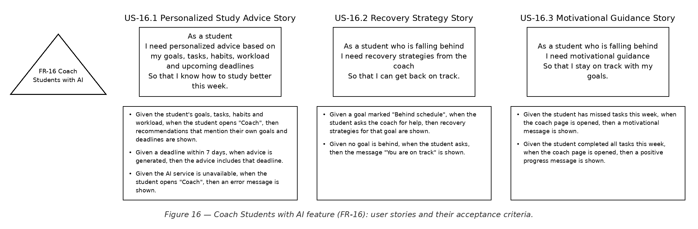

| Story | User story | Acceptance criteria | Covers | Priority |
|---|---|---|---|---|
| US-16.1 Personalized Study Advice Story | As a student, I need personalized advice based on my goals, tasks, habits, workload and upcoming deadlines, so that I know how to study better this week. | • Given the student's goals, tasks, habits and workload, when the student opens "Coach", then recommendations that mention their own goals and deadlines are shown.<br>• Given a deadline within 7 days, when advice is generated, then the advice includes that deadline.<br>• Given the AI service is unavailable, when the student opens "Coach", then an error message is shown. | FR-16.1, FR-16.2 | Low |
| US-16.2 Recovery Strategy Story | As a student who is falling behind, I need recovery strategies from the coach, so that I can get back on track. | • Given a goal marked "Behind schedule", when the student asks the coach for help, then recovery strategies for that goal are shown.<br>• Given no goal is behind, when the student asks, then the message "You are on track" is shown. | FR-16.3 | Low |
| US-16.3 Motivational Guidance Story | As a student who is falling behind, I need motivational guidance, so that I stay on track with my goals. | • Given the student has missed tasks this week, when the coach page is opened, then a motivational message is shown.<br>• Given the student completed all tasks this week, when the coach page is opened, then a positive progress message is shown. | FR-16.4 | Low |

### FR-17 — Display Student Dashboard
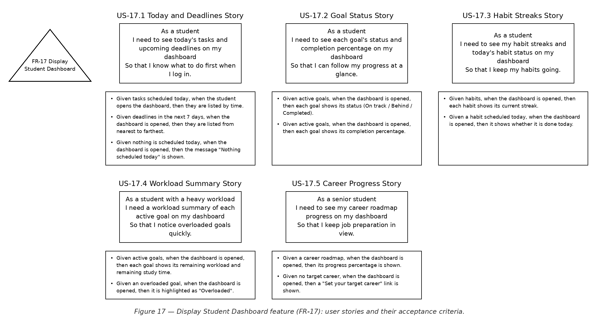

| Story | User story | Acceptance criteria | Covers | Priority |
|---|---|---|---|---|
| US-17.1 Today and Deadlines Story | As a student, I need to see today's tasks and upcoming deadlines on my dashboard, so that I know what to do first when I log in. | • Given tasks scheduled today, when the student opens the dashboard, then they are listed by time.<br>• Given deadlines in the next 7 days, when the dashboard is opened, then they are listed from nearest to farthest.<br>• Given nothing is scheduled today, when the dashboard is opened, then the message "Nothing scheduled today" is shown. | FR-17.1 | High |
| US-17.2 Goal Status Story | As a student, I need to see each goal's status and completion percentage on my dashboard, so that I can follow my progress at a glance. | • Given active goals, when the dashboard is opened, then each goal shows its status (On track / Behind / Completed).<br>• Given active goals, when the dashboard is opened, then each goal shows its completion percentage. | FR-17.2, FR-17.3 | High |
| US-17.3 Habit Streaks Story | As a student, I need to see my habit streaks and today's habit status on my dashboard, so that I keep my habits going. | • Given habits, when the dashboard is opened, then each habit shows its current streak.<br>• Given a habit scheduled today, when the dashboard is opened, then it shows whether it is done today. | FR-17.4 | High |
| US-17.4 Workload Summary Story | As a student with a heavy workload, I need a workload summary of each active goal on my dashboard, so that I notice overloaded goals quickly. | • Given active goals, when the dashboard is opened, then each goal shows its remaining workload and remaining study time.<br>• Given an overloaded goal, when the dashboard is opened, then it is highlighted as "Overloaded". | FR-17.5 | Medium |
| US-17.5 Career Progress Story | As a senior student, I need to see my career roadmap progress on my dashboard, so that I keep job preparation in view. | • Given a career roadmap, when the dashboard is opened, then its progress percentage is shown.<br>• Given no target career, when the dashboard is opened, then a "Set your target career" link is shown. | FR-17.6 | Low |

### FR-18 — Send Notifications
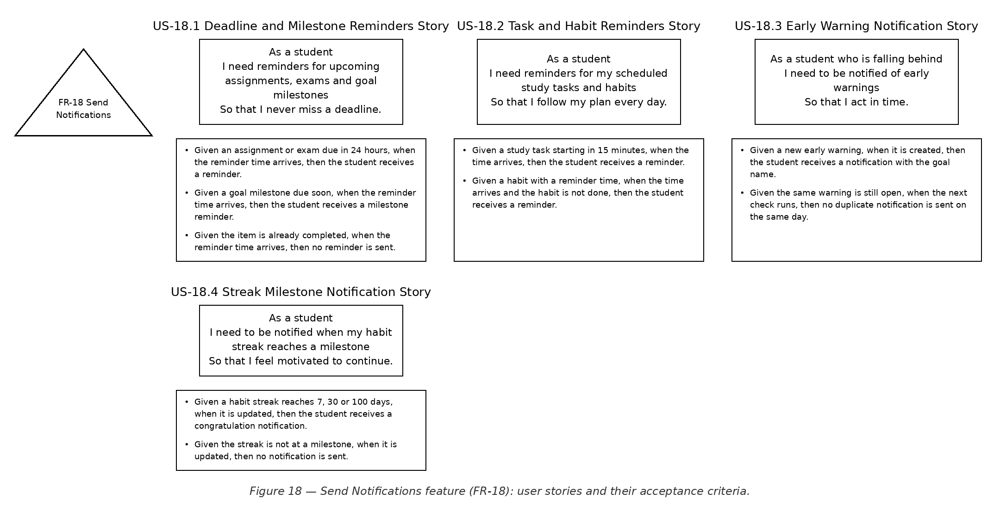

| Story | User story | Acceptance criteria | Covers | Priority |
|---|---|---|---|---|
| US-18.1 Deadline and Milestone Reminders Story | As a student, I need reminders for upcoming assignments, exams and goal milestones, so that I never miss a deadline. | • Given an assignment or exam due in 24 hours, when the reminder time arrives, then the student receives a reminder.<br>• Given a goal milestone due soon, when the reminder time arrives, then the student receives a milestone reminder.<br>• Given the item is already completed, when the reminder time arrives, then no reminder is sent. | FR-18.1, FR-18.5 | High |
| US-18.2 Task and Habit Reminders Story | As a student, I need reminders for my scheduled study tasks and habits, so that I follow my plan every day. | • Given a study task starting in 15 minutes, when the time arrives, then the student receives a reminder.<br>• Given a habit with a reminder time, when the time arrives and the habit is not done, then the student receives a reminder. | FR-18.2, FR-18.3 | High |
| US-18.3 Early Warning Notification Story | As a student who is falling behind, I need to be notified of early warnings, so that I act in time. | • Given a new early warning, when it is created, then the student receives a notification with the goal name.<br>• Given the same warning is still open, when the next check runs, then no duplicate notification is sent on the same day. | FR-18.4 | Medium |
| US-18.4 Streak Milestone Notification Story | As a student, I need to be notified when my habit streak reaches a milestone, so that I feel motivated to continue. | • Given a habit streak reaches 7, 30 or 100 days, when it is updated, then the student receives a congratulation notification.<br>• Given the streak is not at a milestone, when it is updated, then no notification is sent. | FR-18.6 | Medium |

### FR-19 — Manage Study Groups and Accountability
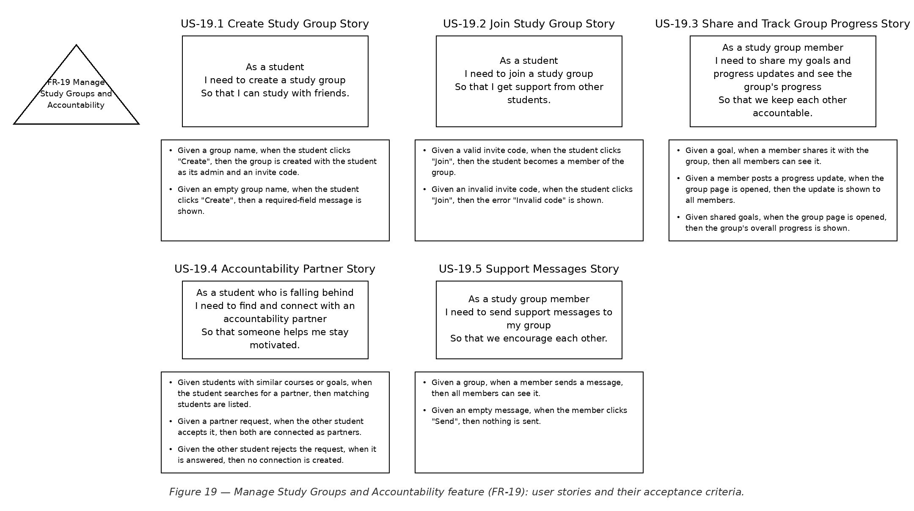

| Story | User story | Acceptance criteria | Covers | Priority |
|---|---|---|---|---|
| US-19.1 Create Study Group Story | As a student, I need to create a study group, so that I can study with friends. | • Given a group name, when the student clicks "Create", then the group is created with the student as its admin and an invite code.<br>• Given an empty group name, when the student clicks "Create", then a required-field message is shown. | FR-19.1 | Low |
| US-19.2 Join Study Group Story | As a student, I need to join a study group, so that I get support from other students. | • Given a valid invite code, when the student clicks "Join", then the student becomes a member of the group.<br>• Given an invalid invite code, when the student clicks "Join", then the error "Invalid code" is shown. | FR-19.2 | Low |
| US-19.3 Share and Track Group Progress Story | As a study group member, I need to share my goals and progress updates and see the group's progress, so that we keep each other accountable. | • Given a goal, when a member shares it with the group, then all members can see it.<br>• Given a member posts a progress update, when the group page is opened, then the update is shown to all members.<br>• Given shared goals, when the group page is opened, then the group's overall progress is shown. | FR-19.3, FR-19.4, FR-19.7 | Low |
| US-19.4 Accountability Partner Story | As a student who is falling behind, I need to find and connect with an accountability partner, so that someone helps me stay motivated. | • Given students with similar courses or goals, when the student searches for a partner, then matching students are listed.<br>• Given a partner request, when the other student accepts it, then both are connected as partners.<br>• Given the other student rejects the request, when it is answered, then no connection is created. | FR-19.5, FR-19.6 | Low |
| US-19.5 Support Messages Story | As a study group member, I need to send support messages to my group, so that we encourage each other. | • Given a group, when a member sends a message, then all members can see it.<br>• Given an empty message, when the member clicks "Send", then nothing is sent. | FR-19.8 | Low |

### FR-20 — Manage Administration
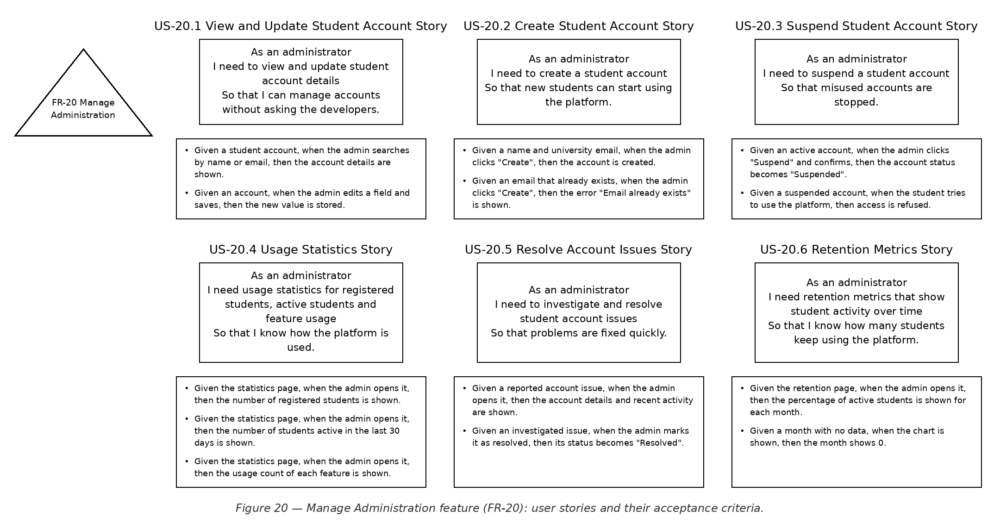

| Story | User story | Acceptance criteria | Covers | Priority |
|---|---|---|---|---|
| US-20.1 View and Update Student Account Story | As an administrator, I need to view and update student account details, so that I can manage accounts without asking the developers. | • Given a student account, when the admin searches by name or email, then the account details are shown.<br>• Given an account, when the admin edits a field and saves, then the new value is stored. | FR-20.1, FR-20.3 | Medium |
| US-20.2 Create Student Account Story | As an administrator, I need to create a student account, so that new students can start using the platform. | • Given a name and university email, when the admin clicks "Create", then the account is created.<br>• Given an email that already exists, when the admin clicks "Create", then the error "Email already exists" is shown. | FR-20.2 | Medium |
| US-20.3 Suspend Student Account Story | As an administrator, I need to suspend a student account, so that misused accounts are stopped. | • Given an active account, when the admin clicks "Suspend" and confirms, then the account status becomes "Suspended".<br>• Given a suspended account, when the student tries to use the platform, then access is refused. | FR-20.4 | Medium |
| US-20.4 Usage Statistics Story | As an administrator, I need usage statistics for registered students, active students and feature usage, so that I know how the platform is used. | • Given the statistics page, when the admin opens it, then the number of registered students is shown.<br>• Given the statistics page, when the admin opens it, then the number of students active in the last 30 days is shown.<br>• Given the statistics page, when the admin opens it, then the usage count of each feature is shown. | FR-20.5, FR-20.6, FR-20.7 | Medium |
| US-20.5 Resolve Account Issues Story | As an administrator, I need to investigate and resolve student account issues, so that problems are fixed quickly. | • Given a reported account issue, when the admin opens it, then the account details and recent activity are shown.<br>• Given an investigated issue, when the admin marks it as resolved, then its status becomes "Resolved". | FR-20.8, FR-20.9 | Medium |
| US-20.6 Retention Metrics Story | As an administrator, I need retention metrics that show student activity over time, so that I know how many students keep using the platform. | • Given the retention page, when the admin opens it, then the percentage of active students is shown for each month.<br>• Given a month with no data, when the chart is shown, then the month shows 0. | FR-20.10 | Low |

## C9 — Estimation & Sprint Plan

**Given (team decisions):** 1 story point = 1 working day. 1 week = 5 working days. Sprint length = 2 weeks (10 working days). Deadline = 12 weeks. Team = 5 developers.

### Planning Poker results

| Feature | User story | Points | Why this size? |
|---|---|---|---|
| FR-01 Manage Student Profile | US-01.1 Create Profile | 3 | Profile form with availability slots + required-field and time-slot validation |
| FR-01 Manage Student Profile | US-01.2 Update Profile | 2 | Re-uses the create form; update + validation |
| FR-01 Manage Student Profile | US-01.3 View Profile | 1 | Read-only profile page |
| FR-02 Manage Academic Goals | US-02.1 Create Goal | 3 | Goal form + validation (required fields, future date) |
| FR-02 Manage Academic Goals | US-02.2 Edit Goal | 2 | Edit existing goal + date validation |
| FR-02 Manage Academic Goals | US-02.3 Complete Goal | 1 | Status change to Completed |
| FR-02 Manage Academic Goals | US-02.4 Archive Goal | 2 | Archive + restore (two status changes and a filtered list) |
| FR-02 Manage Academic Goals | US-02.5 Delete Goal | 1 | Delete with confirmation |
| FR-03 Manage Courses | US-03.1 Add Course | 3 | Course form + credits/workload + duplicate-code check |
| FR-03 Manage Courses | US-03.2 View Course Progress | 3 | Joins course with its assignments, completed vs outstanding |
| FR-03 Manage Courses | US-03.3 Update Course | 2 | Edit course + duplicate-code check |
| FR-03 Manage Courses | US-03.4 Remove Course | 2 | Remove course + cascade warning for its assignments |
| FR-04 Manage Assignments and Exams | US-04.1 Add Assignment | 3 | Assignment form + validation + default status |
| FR-04 Manage Assignments and Exams | US-04.2 Add Exam | 2 | Exam form re-uses the assignment form pattern |
| FR-04 Manage Assignments and Exams | US-04.3 Track Assignment Status | 2 | Status change that also updates course progress |
| FR-04 Manage Assignments and Exams | US-04.4 Exam Preparation Reminder | 2 | Reminder setting saved with the exam + date check |
| FR-05 Plan Goals with AI | US-05.1 Generate Goal Plan | 8 | First AI integration: prompt, call, parse milestones/tasks, AI-unavailable handling |
| FR-05 Plan Goals with AI | US-05.2 Review and Edit AI Plan | 5 | Editable review screen for both milestones and tasks, nothing saved before approval |
| FR-05 Plan Goals with AI | US-05.3 Approve AI Plan | 2 | Approve saves the reviewed plan; discard drops it |
| FR-06 Generate Study Plans | US-06.1 Generate Study Plan | 8 | AI plan within availability + priority placement + schema validation + keep previous plan (re-uses AI client from US-05.1) |
| FR-06 Generate Study Plans | US-06.2 Regenerate Study Plan | 3 | Re-runs generation with new data; keeps old plan on failure |
| FR-07 Enable Smart Scheduling | US-07.1 Auto-Schedule Tasks | 8 | Scheduling algorithm: deadlines, priorities, availability and task dependencies |
| FR-07 Enable Smart Scheduling | US-07.2 Resolve Scheduling Conflicts | 5 | Overlap detection + finding free alternative slots |
| FR-07 Enable Smart Scheduling | US-07.3 Adjust Schedule Manually | 3 | Move a task to a new slot + conflict warning |
| FR-07 Enable Smart Scheduling | US-07.4 Mark Task Done | 2 | Status change on a scheduled task that updates progress and remaining workload |
| FR-08 Enable Adaptive Planning | US-08.1 Detect Falling Behind | 3 | Rule: past, unfinished tasks → Behind schedule |
| FR-08 Enable Adaptive Planning | US-08.2 Get Re-planning Recommendations | 5 | Builds reschedule/reprioritize suggestions from the schedule |
| FR-08 Enable Adaptive Planning | US-08.3 Respond to Recommendations | 3 | Accept / reject / modify flow with approval before applying |
| FR-09 Manage Career Roadmaps | US-09.1 Choose Target Career | 2 | Select from a list or enter a custom career + validation |
| FR-09 Manage Career Roadmaps | US-09.2 Generate Career Roadmap | 5 | AI roadmap generation (re-uses the AI client) + error handling |
| FR-09 Manage Career Roadmaps | US-09.3 Track Roadmap Progress | 2 | Mark milestones done + progress percentage |
| FR-09 Manage Career Roadmaps | US-09.4 Change Target Career | 3 | Change career + trigger roadmap regeneration |
| FR-10 Track Skills | US-10.1 Add Skill | 2 | Skill form + duplicate check |
| FR-10 Track Skills | US-10.2 View Skill Gaps | 5 | Compare skills and levels with the roadmap's required skills |
| FR-10 Track Skills | US-10.3 Update Skill Level | 1 | Update one field; gaps re-use US-10.2 |
| FR-11 Manage Projects and Portfolios | US-11.1 Add Project | 5 | Project form + URL validation + document upload |
| FR-11 Manage Projects and Portfolios | US-11.2 Link Project to Skills | 3 | Many-to-many link between projects and skills, shown both ways |
| FR-11 Manage Projects and Portfolios | US-11.3 View Portfolio | 3 | Portfolio page: completed projects with links and skills |
| FR-12 Manage Internship and Job Preparation | US-12.1 Track Applications | 3 | Application form + status changes + deadline check |
| FR-12 Manage Internship and Job Preparation | US-12.2 Interview Preparation | 2 | Checklist of preparation tasks per application |
| FR-12 Manage Internship and Job Preparation | US-12.3 Track CV and Portfolio Updates | 3 | Two item lists (CV and portfolio updates) per application |
| FR-12 Manage Internship and Job Preparation | US-12.4 Record Outcome and Feedback | 2 | Outcome field + feedback text |
| FR-13 Manage Habits | US-13.1 Create Habit | 3 | Habit form with frequency and reminder + validation |
| FR-13 Manage Habits | US-13.2 Complete Habit and Keep Streak | 3 | Daily completion + streak calculation and reset |
| FR-13 Manage Habits | US-13.3 Link Habit to Goal | 2 | Link habit to goal + inactive state when the goal is archived |
| FR-14 Analyze Study Workload | US-14.1 View Goal Workload | 5 | Three calculations (remaining work, available time, % completed) + display |
| FR-14 Analyze Study Workload | US-14.2 Overloaded Goal | 2 | One comparison rule on top of US-14.1 |
| FR-15 Predict and Warn Early | US-15.1 Completion Likelihood | 5 | Likelihood rule from % completed and remaining time + no-data case |
| FR-15 Predict and Warn Early | US-15.2 Early Warning | 5 | Creates/closes warnings and finds the tasks that cause the overload |
| FR-15 Predict and Warn Early | US-15.3 Recovery Actions | 3 | Suggests actions and recalculates after one is applied |
| FR-16 Coach Students with AI | US-16.1 Personalized Study Advice | 5 | AI advice from goals, tasks, habits and workload (re-uses AI client) |
| FR-16 Coach Students with AI | US-16.2 Recovery Strategy | 3 | Coach response for goals that are behind |
| FR-16 Coach Students with AI | US-16.3 Motivational Guidance | 2 | Message chosen from the week's completion |
| FR-17 Display Student Dashboard | US-17.1 Today and Deadlines | 3 | Dashboard layout + today's tasks + 7-day deadlines |
| FR-17 Display Student Dashboard | US-17.2 Goal Status | 2 | Goal status and % widget (data from goals) |
| FR-17 Display Student Dashboard | US-17.3 Habit Streaks | 2 | Habit streak widget (data from habits) |
| FR-17 Display Student Dashboard | US-17.4 Workload Summary | 2 | Workload widget (data from US-14.1) + overload highlight |
| FR-17 Display Student Dashboard | US-17.5 Career Progress | 1 | One progress value from the career roadmap |
| FR-18 Send Notifications | US-18.1 Deadline and Milestone Reminders | 5 | Reminder scheduler + email gateway + skip completed items |
| FR-18 Send Notifications | US-18.2 Task and Habit Reminders | 3 | Two more reminder types on the scheduler from US-18.1 |
| FR-18 Send Notifications | US-18.3 Early Warning Notification | 2 | Notification on new warning + no duplicates per day |
| FR-18 Send Notifications | US-18.4 Streak Milestone Notification | 2 | Notification on streak milestones (7/30/100) |
| FR-19 Manage Study Groups and Accountability | US-19.1 Create Study Group | 2 | Create group + invite code |
| FR-19 Manage Study Groups and Accountability | US-19.2 Join Study Group | 2 | Join by invite code + invalid-code error |
| FR-19 Manage Study Groups and Accountability | US-19.3 Share and Track Group Progress | 5 | Share goals, post updates and group progress for all members |
| FR-19 Manage Study Groups and Accountability | US-19.4 Accountability Partner | 5 | Partner matching + request / accept / reject flow |
| FR-19 Manage Study Groups and Accountability | US-19.5 Support Messages | 3 | Group message list + send |
| FR-20 Manage Administration | US-20.1 View and Update Student Account | 3 | Search accounts + view and edit details |
| FR-20 Manage Administration | US-20.2 Create Student Account | 2 | Create account + duplicate-email check |
| FR-20 Manage Administration | US-20.3 Suspend Student Account | 2 | Suspend + refuse access to suspended accounts |
| FR-20 Manage Administration | US-20.4 Usage Statistics | 5 | Three statistics queries + statistics page |
| FR-20 Manage Administration | US-20.5 Resolve Account Issues | 3 | Issue view with account activity + resolve status |
| FR-20 Manage Administration | US-20.6 Retention Metrics | 3 | Monthly retention calculation + chart |
| **Total** | **73 stories** | **225** | |

### Computed values

**1. Total points**

```
Total points = Σ story points
             = 6 + 9 + 10 + 9 + 15 + 11 + 18 + 11 + 12 + 8 + 11 + 10 + 8 + 7 + 13 + 10 + 10 + 12 + 17 + 18   (FR-01 … FR-20)
             = 225 points
```

**2. Effort (person-days)**

```
Effort = total points × days per point
       = 225 × 1
       = 225 person-days
```

**3. Effort (person-weeks)**

```
Effort = person-days ÷ 5
       = 225 ÷ 5
       = 45 person-weeks
```

**4. Team size**

```
Team size = effort (person-weeks) ÷ deadline (weeks) → round up
          = 45 ÷ 12
          = 3.75 → 4 developers
```

**5. Capacity check**

```
Capacity = team size × weeks ≥ required effort
         = 4 × 12 = 48 person-weeks ≥ 45 ✔
Why not 3? 3 × 12 = 36 < 45 ✘ — the deadline would be missed.
Our team (5): 5 × 12 = 60 person-weeks ≥ 45 ✔
```

**6. Sprint capacity**

```
Sprint capacity = developers × working days per sprint ÷ days per point
                = 5 × 10 ÷ 1
                = 50 points per sprint
```

**7. Actual velocity**

```
Actual velocity = completed story points per sprint
No sprint is finished yet → planned velocity = sprint capacity
                = 50 points per sprint (actual velocity reported after every sprint, from PM1)
```

**8. Schedule (weeks)**

```
Schedule = effort (person-weeks) ÷ team size → round up
         = 45 ÷ 5
         = 9 → 9 weeks
```

**9. Number of sprints**

```
Number of sprints = total points ÷ sprint capacity → round up
                  = 225 ÷ 50
                  = 4.5 → 5 sprints = 10 weeks ≤ 12 weeks ✔
```

**10. Max scope (points)**

```
Max scope = team size × weeks × 5 ÷ days per point
          = 5 × 12 × 5 ÷ 1
          = 300 points ≥ 225 ✔ (no story has to be removed)
```

### Sprint plan (by priority)

| Sprint | Weeks | User stories | Points | Fits? (≤ 50) |
|---|---|---|---|---|
| Sprint 1 | 1–2 | US-01.1 Create Profile (3), US-01.3 View Profile (1), US-01.2 Update Profile (2), US-02.1 Create Goal (3), US-02.2 Edit Goal (2), US-02.3 Complete Goal (1), US-03.1 Add Course (3), US-04.1 Add Assignment (3), US-04.2 Add Exam (2), US-04.3 Track Assignment Status (2), US-03.2 View Course Progress (3), US-13.1 Create Habit (3), US-13.2 Complete Habit and Keep Streak (3), US-05.1 Generate Goal Plan (8), US-05.2 Review and Edit AI Plan (5), US-05.3 Approve AI Plan (2) | 46 | ✔ |
| Sprint 2 | 3–4 | US-06.1 Generate Study Plan (8), US-07.1 Auto-Schedule Tasks (8), US-07.4 Mark Task Done (2), US-07.2 Resolve Scheduling Conflicts (5), US-08.1 Detect Falling Behind (3), US-17.1 Today and Deadlines (3), US-17.2 Goal Status (2), US-17.3 Habit Streaks (2), US-18.1 Deadline and Milestone Reminders (5), US-18.2 Task and Habit Reminders (3), US-02.4 Archive Goal (2), US-02.5 Delete Goal (1), US-03.3 Update Course (2), US-03.4 Remove Course (2), US-04.4 Exam Preparation Reminder (2) | 50 | ✔ |
| Sprint 3 | 5–6 | US-06.2 Regenerate Study Plan (3), US-07.3 Adjust Schedule Manually (3), US-13.3 Link Habit to Goal (2), US-14.1 View Goal Workload (5), US-14.2 Overloaded Goal (2), US-08.2 Get Re-planning Recommendations (5), US-08.3 Respond to Recommendations (3), US-15.1 Completion Likelihood (5), US-15.2 Early Warning (5), US-15.3 Recovery Actions (3), US-17.4 Workload Summary (2), US-18.3 Early Warning Notification (2), US-18.4 Streak Milestone Notification (2), US-20.2 Create Student Account (2), US-20.1 View and Update Student Account (3), US-20.3 Suspend Student Account (2) | 49 | ✔ |
| Sprint 4 | 7–8 | US-20.4 Usage Statistics (5), US-20.5 Resolve Account Issues (3), US-09.1 Choose Target Career (2), US-09.2 Generate Career Roadmap (5), US-09.3 Track Roadmap Progress (2), US-09.4 Change Target Career (3), US-10.1 Add Skill (2), US-10.2 View Skill Gaps (5), US-10.3 Update Skill Level (1), US-11.1 Add Project (5), US-11.2 Link Project to Skills (3), US-11.3 View Portfolio (3), US-12.1 Track Applications (3), US-12.2 Interview Preparation (2), US-12.3 Track CV and Portfolio Updates (3), US-12.4 Record Outcome and Feedback (2) | 49 | ✔ |
| Sprint 5 | 9–10 | US-16.1 Personalized Study Advice (5), US-16.2 Recovery Strategy (3), US-16.3 Motivational Guidance (2), US-17.5 Career Progress (1), US-19.1 Create Study Group (2), US-19.2 Join Study Group (2), US-19.3 Share and Track Group Progress (5), US-19.4 Accountability Partner (5), US-19.5 Support Messages (3), US-20.6 Retention Metrics (3) | 31 | ✔ |
| Sprint 6 | 11–12 | Buffer for unfinished stories | 0 | ✔ |

- US-06.1 is next after Sprint 1, but 46 + 8 = 54 > 50 ✘, so it moves to the top of Sprint 2.
- US-06.2 is next after Sprint 2, but 50 + 3 = 53 > 50 ✘, so it moves to the top of Sprint 3.
- US-20.4 is next after Sprint 3, but 49 + 5 = 54 > 50 ✘, so it moves to the top of Sprint 4.
- US-16.1 is next after Sprint 4, but 49 + 5 = 54 > 50 ✘, so it moves to the top of Sprint 5.

### Burndown

| Point in time | Remaining (ideal) | Remaining (planned) | Remaining (actual) |
|---|---|---|---|
| Start | 225 | 225 | 225 |
| End of Sprint 1 | 180 | 179 | — |
| End of Sprint 2 | 135 | 129 | — |
| End of Sprint 3 | 90 | 80 | — |
| End of Sprint 4 | 45 | 31 | — |
| End of Sprint 5 | 0 | 0 | — |

The ideal line drops by the same amount every sprint (225 ÷ 5 = 45); the planned line follows the sprint plan. The actual column is filled in after each sprint.

## C10 — PERT Estimation Error

For every story the team gave three estimates in days: **O** (optimistic), **M** (most likely = points × 1 day, from C9) and **P** (pessimistic). O and P depend on how uncertain the story is: simple screens and forms have P close to M, while stories that use the AI provider, the email service or the scheduling algorithm have a much larger P. P is always farther from M than O, because things go wrong more often than they go better.

```
E  = (O + 4M + P) ÷ 6
SD = (P − O) ÷ 6
```

| User story | O (days) | M (days) | P (days) | E = (O+4M+P)/6 | SD = (P−O)/6 |
|---|---|---|---|---|---|
| US-01.1 Create Profile | 2 | 3 | 5 | 19 ÷ 6 = 3.17 | 3 ÷ 6 = 0.50 |
| US-01.2 Update Profile | 1.5 | 2 | 3 | 12.5 ÷ 6 = 2.08 | 1.5 ÷ 6 = 0.25 |
| US-01.3 View Profile | 0.5 | 1 | 2 | 6.5 ÷ 6 = 1.08 | 1.5 ÷ 6 = 0.25 |
| US-02.1 Create Goal | 2 | 3 | 5 | 19 ÷ 6 = 3.17 | 3 ÷ 6 = 0.50 |
| US-02.2 Edit Goal | 1.5 | 2 | 3 | 12.5 ÷ 6 = 2.08 | 1.5 ÷ 6 = 0.25 |
| US-02.3 Complete Goal | 0.5 | 1 | 2 | 6.5 ÷ 6 = 1.08 | 1.5 ÷ 6 = 0.25 |
| US-02.4 Archive Goal | 1.5 | 2 | 3 | 12.5 ÷ 6 = 2.08 | 1.5 ÷ 6 = 0.25 |
| US-02.5 Delete Goal | 0.5 | 1 | 2 | 6.5 ÷ 6 = 1.08 | 1.5 ÷ 6 = 0.25 |
| US-03.1 Add Course | 2 | 3 | 5 | 19 ÷ 6 = 3.17 | 3 ÷ 6 = 0.50 |
| US-03.2 View Course Progress | 2 | 3 | 6 | 20 ÷ 6 = 3.33 | 4 ÷ 6 = 0.67 |
| US-03.3 Update Course | 1.5 | 2 | 3 | 12.5 ÷ 6 = 2.08 | 1.5 ÷ 6 = 0.25 |
| US-03.4 Remove Course | 1.5 | 2 | 3 | 12.5 ÷ 6 = 2.08 | 1.5 ÷ 6 = 0.25 |
| US-04.1 Add Assignment | 2 | 3 | 5 | 19 ÷ 6 = 3.17 | 3 ÷ 6 = 0.50 |
| US-04.2 Add Exam | 1.5 | 2 | 3 | 12.5 ÷ 6 = 2.08 | 1.5 ÷ 6 = 0.25 |
| US-04.3 Track Assignment Status | 1.5 | 2 | 3 | 12.5 ÷ 6 = 2.08 | 1.5 ÷ 6 = 0.25 |
| US-04.4 Exam Preparation Reminder | 1.5 | 2 | 3 | 12.5 ÷ 6 = 2.08 | 1.5 ÷ 6 = 0.25 |
| US-05.1 Generate Goal Plan | 6 | 8 | 18 | 56 ÷ 6 = 9.33 | 12 ÷ 6 = 2.00 |
| US-05.2 Review and Edit AI Plan | 4 | 5 | 10 | 34 ÷ 6 = 5.67 | 6 ÷ 6 = 1.00 |
| US-05.3 Approve AI Plan | 1.5 | 2 | 3 | 12.5 ÷ 6 = 2.08 | 1.5 ÷ 6 = 0.25 |
| US-06.1 Generate Study Plan | 6 | 8 | 18 | 56 ÷ 6 = 9.33 | 12 ÷ 6 = 2.00 |
| US-06.2 Regenerate Study Plan | 2 | 3 | 8 | 22 ÷ 6 = 3.67 | 6 ÷ 6 = 1.00 |
| US-07.1 Auto-Schedule Tasks | 6 | 8 | 18 | 56 ÷ 6 = 9.33 | 12 ÷ 6 = 2.00 |
| US-07.2 Resolve Scheduling Conflicts | 4 | 5 | 10 | 34 ÷ 6 = 5.67 | 6 ÷ 6 = 1.00 |
| US-07.3 Adjust Schedule Manually | 2 | 3 | 6 | 20 ÷ 6 = 3.33 | 4 ÷ 6 = 0.67 |
| US-07.4 Mark Task Done | 1.5 | 2 | 3 | 12.5 ÷ 6 = 2.08 | 1.5 ÷ 6 = 0.25 |
| US-08.1 Detect Falling Behind | 2 | 3 | 6 | 20 ÷ 6 = 3.33 | 4 ÷ 6 = 0.67 |
| US-08.2 Get Re-planning Recommendations | 4 | 5 | 10 | 34 ÷ 6 = 5.67 | 6 ÷ 6 = 1.00 |
| US-08.3 Respond to Recommendations | 2 | 3 | 6 | 20 ÷ 6 = 3.33 | 4 ÷ 6 = 0.67 |
| US-09.1 Choose Target Career | 1.5 | 2 | 3 | 12.5 ÷ 6 = 2.08 | 1.5 ÷ 6 = 0.25 |
| US-09.2 Generate Career Roadmap | 4 | 5 | 12 | 36 ÷ 6 = 6.00 | 8 ÷ 6 = 1.33 |
| US-09.3 Track Roadmap Progress | 1.5 | 2 | 3 | 12.5 ÷ 6 = 2.08 | 1.5 ÷ 6 = 0.25 |
| US-09.4 Change Target Career | 2 | 3 | 8 | 22 ÷ 6 = 3.67 | 6 ÷ 6 = 1.00 |
| US-10.1 Add Skill | 1.5 | 2 | 3 | 12.5 ÷ 6 = 2.08 | 1.5 ÷ 6 = 0.25 |
| US-10.2 View Skill Gaps | 4 | 5 | 10 | 34 ÷ 6 = 5.67 | 6 ÷ 6 = 1.00 |
| US-10.3 Update Skill Level | 0.5 | 1 | 2 | 6.5 ÷ 6 = 1.08 | 1.5 ÷ 6 = 0.25 |
| US-11.1 Add Project | 4 | 5 | 10 | 34 ÷ 6 = 5.67 | 6 ÷ 6 = 1.00 |
| US-11.2 Link Project to Skills | 2 | 3 | 6 | 20 ÷ 6 = 3.33 | 4 ÷ 6 = 0.67 |
| US-11.3 View Portfolio | 2 | 3 | 5 | 19 ÷ 6 = 3.17 | 3 ÷ 6 = 0.50 |
| US-12.1 Track Applications | 2 | 3 | 5 | 19 ÷ 6 = 3.17 | 3 ÷ 6 = 0.50 |
| US-12.2 Interview Preparation | 1.5 | 2 | 3 | 12.5 ÷ 6 = 2.08 | 1.5 ÷ 6 = 0.25 |
| US-12.3 Track CV and Portfolio Updates | 2 | 3 | 5 | 19 ÷ 6 = 3.17 | 3 ÷ 6 = 0.50 |
| US-12.4 Record Outcome and Feedback | 1.5 | 2 | 3 | 12.5 ÷ 6 = 2.08 | 1.5 ÷ 6 = 0.25 |
| US-13.1 Create Habit | 2 | 3 | 5 | 19 ÷ 6 = 3.17 | 3 ÷ 6 = 0.50 |
| US-13.2 Complete Habit and Keep Streak | 2 | 3 | 6 | 20 ÷ 6 = 3.33 | 4 ÷ 6 = 0.67 |
| US-13.3 Link Habit to Goal | 1.5 | 2 | 3 | 12.5 ÷ 6 = 2.08 | 1.5 ÷ 6 = 0.25 |
| US-14.1 View Goal Workload | 4 | 5 | 10 | 34 ÷ 6 = 5.67 | 6 ÷ 6 = 1.00 |
| US-14.2 Overloaded Goal | 1.5 | 2 | 3 | 12.5 ÷ 6 = 2.08 | 1.5 ÷ 6 = 0.25 |
| US-15.1 Completion Likelihood | 4 | 5 | 10 | 34 ÷ 6 = 5.67 | 6 ÷ 6 = 1.00 |
| US-15.2 Early Warning | 4 | 5 | 10 | 34 ÷ 6 = 5.67 | 6 ÷ 6 = 1.00 |
| US-15.3 Recovery Actions | 2 | 3 | 6 | 20 ÷ 6 = 3.33 | 4 ÷ 6 = 0.67 |
| US-16.1 Personalized Study Advice | 4 | 5 | 12 | 36 ÷ 6 = 6.00 | 8 ÷ 6 = 1.33 |
| US-16.2 Recovery Strategy | 2 | 3 | 8 | 22 ÷ 6 = 3.67 | 6 ÷ 6 = 1.00 |
| US-16.3 Motivational Guidance | 1.5 | 2 | 3 | 12.5 ÷ 6 = 2.08 | 1.5 ÷ 6 = 0.25 |
| US-17.1 Today and Deadlines | 2 | 3 | 5 | 19 ÷ 6 = 3.17 | 3 ÷ 6 = 0.50 |
| US-17.2 Goal Status | 1.5 | 2 | 3 | 12.5 ÷ 6 = 2.08 | 1.5 ÷ 6 = 0.25 |
| US-17.3 Habit Streaks | 1.5 | 2 | 3 | 12.5 ÷ 6 = 2.08 | 1.5 ÷ 6 = 0.25 |
| US-17.4 Workload Summary | 1.5 | 2 | 3 | 12.5 ÷ 6 = 2.08 | 1.5 ÷ 6 = 0.25 |
| US-17.5 Career Progress | 0.5 | 1 | 2 | 6.5 ÷ 6 = 1.08 | 1.5 ÷ 6 = 0.25 |
| US-18.1 Deadline and Milestone Reminders | 4 | 5 | 12 | 36 ÷ 6 = 6.00 | 8 ÷ 6 = 1.33 |
| US-18.2 Task and Habit Reminders | 2 | 3 | 6 | 20 ÷ 6 = 3.33 | 4 ÷ 6 = 0.67 |
| US-18.3 Early Warning Notification | 1.5 | 2 | 3 | 12.5 ÷ 6 = 2.08 | 1.5 ÷ 6 = 0.25 |
| US-18.4 Streak Milestone Notification | 1.5 | 2 | 3 | 12.5 ÷ 6 = 2.08 | 1.5 ÷ 6 = 0.25 |
| US-19.1 Create Study Group | 1.5 | 2 | 3 | 12.5 ÷ 6 = 2.08 | 1.5 ÷ 6 = 0.25 |
| US-19.2 Join Study Group | 1.5 | 2 | 3 | 12.5 ÷ 6 = 2.08 | 1.5 ÷ 6 = 0.25 |
| US-19.3 Share and Track Group Progress | 4 | 5 | 10 | 34 ÷ 6 = 5.67 | 6 ÷ 6 = 1.00 |
| US-19.4 Accountability Partner | 4 | 5 | 10 | 34 ÷ 6 = 5.67 | 6 ÷ 6 = 1.00 |
| US-19.5 Support Messages | 2 | 3 | 5 | 19 ÷ 6 = 3.17 | 3 ÷ 6 = 0.50 |
| US-20.1 View and Update Student Account | 2 | 3 | 5 | 19 ÷ 6 = 3.17 | 3 ÷ 6 = 0.50 |
| US-20.2 Create Student Account | 1.5 | 2 | 3 | 12.5 ÷ 6 = 2.08 | 1.5 ÷ 6 = 0.25 |
| US-20.3 Suspend Student Account | 1.5 | 2 | 3 | 12.5 ÷ 6 = 2.08 | 1.5 ÷ 6 = 0.25 |
| US-20.4 Usage Statistics | 4 | 5 | 10 | 34 ÷ 6 = 5.67 | 6 ÷ 6 = 1.00 |
| US-20.5 Resolve Account Issues | 2 | 3 | 5 | 19 ÷ 6 = 3.17 | 3 ÷ 6 = 0.50 |
| US-20.6 Retention Metrics | 2 | 3 | 6 | 20 ÷ 6 = 3.33 | 4 ÷ 6 = 0.67 |
| **Total** | | **225** | | **249.00** | |

### Step 1 — Estimation error of one story

```
US-05.1 Generate Goal Plan: E = 9.33 days, SD = 2.00
Range (68%) = 9.33 ± 2.00 → from about 7.33 to 11.33 days
```

US-05.1 Generate Goal Plan, US-06.1 Generate Study Plan, US-07.1 Auto-Schedule Tasks have the largest SD (2.00) → they are the riskiest stories; the team should watch them closely.

### Step 2 — Total expected effort

```
E(total) = Σ (O + 4M + P) ÷ 6 = 1494 ÷ 6 = 249.00 person-days
Single-point estimate (ΣM) = 225 person-days
Difference = 249.00 − 225 = 24.00 days
Percentage = 24.00 ÷ 225 × 100 = 10.7%
```

The single-point estimate was **24.00 days (10.7%) optimistic**: it planned for less work than the team will most probably need.

The total is computed from unrounded per-story values. The per-story rows are rounded to two decimals, so summing the displayed rows gives 248.94 rather than 249.00.

### Step 3 — Is the team still enough?

```
Effort (person-weeks) = 249.00 ÷ 5 = 49.80 person-weeks
Team size = 49.80 ÷ 12 = 4.15 → round up → 5 developers
Capacity = 5 × 12 = 60 person-weeks ≥ 49.80 ✔
Number of sprints = 249.00 ÷ 50 = 4.98 → 5 sprints ≤ 6 ✔
```

**Yes, the team is still enough.** Our 5 developers can still finish before the deadline, but with a smaller safety margin (60 vs. 49.80 instead of 60 vs. 45), and the team needed is now exactly our 5 developers. Sprint 6 is kept free as a buffer for overruns.

## C11 — Jira Board

### Jira details

| Field | Value |
| --- | --- |
| **Jira site** | https://aspirra.atlassian.net |
| **Project name** | Aspirra Project |
| **Project key** | SCRUM |
| **Board** | SCRUM board (Board ID: 1) |
| **Issue types used** | Epic, Task (stories created as Task with `story` label; no native `Story` issue type available) |
| **Team-managed** | Yes |

### Epics

- Created **20 epics** (one per high-level functional requirement FR-01–FR-20), linked via parent relationship.
- Epic keys: **SCRUM-10** (FR-01) through **SCRUM-27** (FR-20).
- Each epic includes owner, service, linked customer requirements, and labels `epic`, `FR-XX`, and the corresponding service label.

### Product backlog (user stories)

- Created **73 user stories** as Jira Tasks (`Task` issue type) with label `story`.
- Stories are linked to their parent epics (e.g., US-01.1–US-01.3 under FR-01 / SCRUM-10).
- Each story includes the user story text, acceptance criteria, traceability (covered low-level FRs), priority, and service labels.
- **Total story points:** **225**.
- **Assignees:** None (stories remain unassigned as requested).
- Story keys range from **SCRUM-101** (US-02.1) to **SCRUM-173** (US-20.6).

### Sprint 1

| Field | Value |
| --- | --- |
| **Sprint ID** | 1 |
| **Sprint name** | Sprint 1 — Foundation |
| **State** | Active |
| **Start date** | 2026-10-22 |
| **End date** | 2026-11-04 |
| **Goal** | Deliver the core academic foundation, profile, goals, courses, assessments, habits, and the first AI goal planner. |
| **Stories committed** | 16 |
| **Points committed** | 46 |

**Sprint 1 stories (by key):** SCRUM-104 (US-01.1, 3), SCRUM-102 (US-01.3, 1), SCRUM-103 (US-01.2, 2), SCRUM-101 (US-02.1, 3), SCRUM-105 (US-02.2, 2), SCRUM-106 (US-02.3, 1), SCRUM-108 (US-03.1, 3), SCRUM-113 (US-04.1, 3), SCRUM-114 (US-04.2, 2), SCRUM-115 (US-04.3, 2), SCRUM-109 (US-03.2, 3), SCRUM-143 (US-13.1, 3), SCRUM-144 (US-13.2, 3), SCRUM-117 (US-05.1, 8), SCRUM-118 (US-05.2, 5), SCRUM-119 (US-05.3, 2).

### Reports

- **Sprint report / burndown:** [SCRUM Sprint 1 — burndown/report](https://aspirra.atlassian.net/jira/software/projects/SCRUM/boards/1/reports/burndown-chart?sprint=1)

### Cleanup performed

- Deleted sample issues **SCRUM-1**–**SCRUM-4**.
- Deleted **SCRUM Sprint 0**.
- Renamed/reconfigured the original future sprint to **Sprint 1 — Foundation** with dates 2026-10-22–2026-11-04, goal set, and state set to **Active**.

## C12 — GitHub Repository

- **Repository:** https://github.com/AIU-SoftWave/Aspirra
- **Branches:** `main` (protected), `develop`, `feature/<service>` per owner
- **Collaborators:** all five team members (TA invitation pending the TA's account details)
- **README:** title/description, team, services and owners, tech stack, folder structure, Jira link

# Part D — GUI Design

Figma GUI screens covering the system functionality.

## D13 — Figma GUI Screens

- **Design source:** Figma; the exported screens are stored in `docs/proposal/gui/`.

### Screens

The mockups below cover the primary student experience of Aspirra.

| # | Screen | Covers functionality |
|---|---|---|
| 1 | Dashboard overview | FR-17 Display Student Dashboard |
| 2 | Goals | FR-02 Manage Academic Goals, FR-05 Plan Goals with AI |
| 3 | Courses | FR-03 Manage Courses |
| 4 | Tasks & Exams | FR-04 Manage Assignments and Exams |
| 5 | Study Planner | FR-06 Generate Study Plans, FR-07 Enable Smart Scheduling, FR-08 Enable Adaptive Planning |
| 6 | Habits | FR-13 Manage Habits |
| 7 | AI Coach | FR-16 Coach Students with AI |
| 8 | Workload & Insights | FR-14 Analyze Study Workload, FR-15 Predict and Warn Early |
| 9 | Career Roadmap | FR-09 Manage Career Roadmaps, FR-10 Track Skills, FR-11 Manage Projects and Portfolios, FR-12 Manage Internship and Job Preparation |
| 10 | Study Groups | FR-19 Manage Study Groups and Accountability |
| 11 | Profile | FR-01 Manage Student Profile |

The administration and notification screens are specified in B4 (FR-18 and FR-20) and are not part of this design export.

#### 1. Dashboard overview

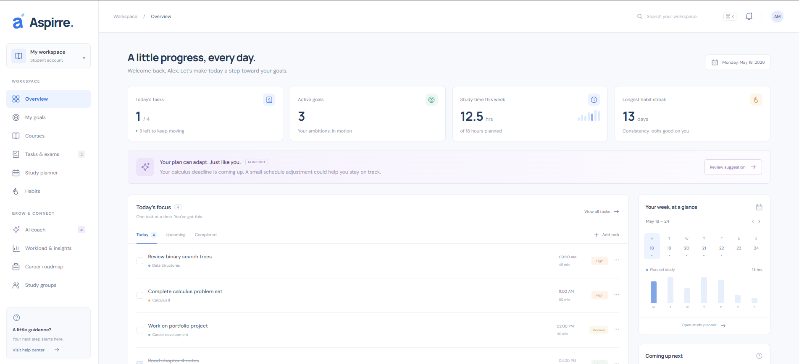

#### 2. Goals


#### 3. Courses


#### 4. Tasks & Exams


#### 5. Study Planner


#### 6. Habits


#### 7. AI Coach


#### 8. Workload & Insights


#### 9. Career Roadmap


#### 10. Study Groups


#### 11. Profile


